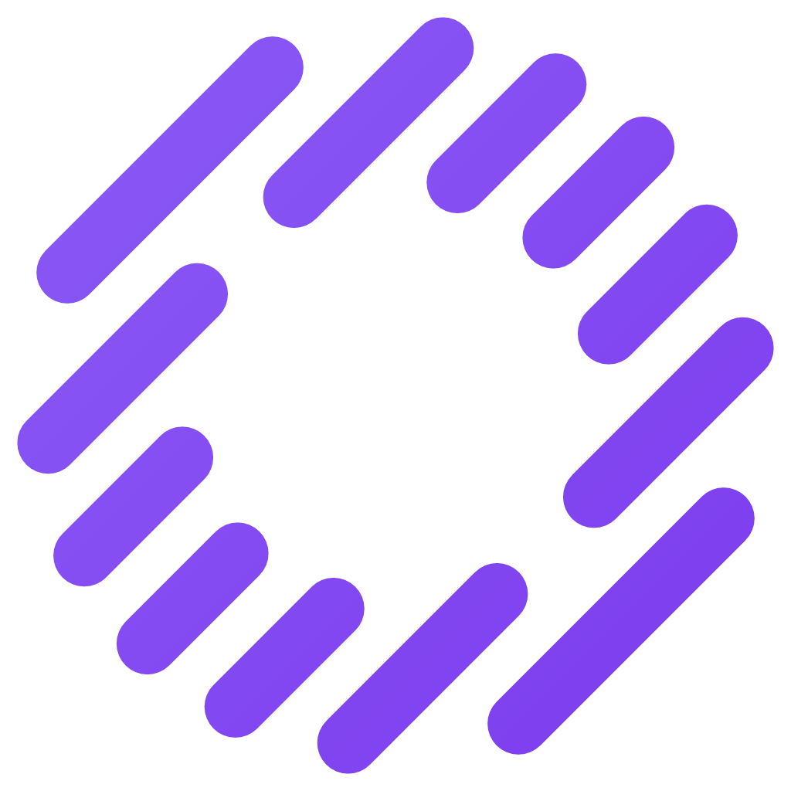
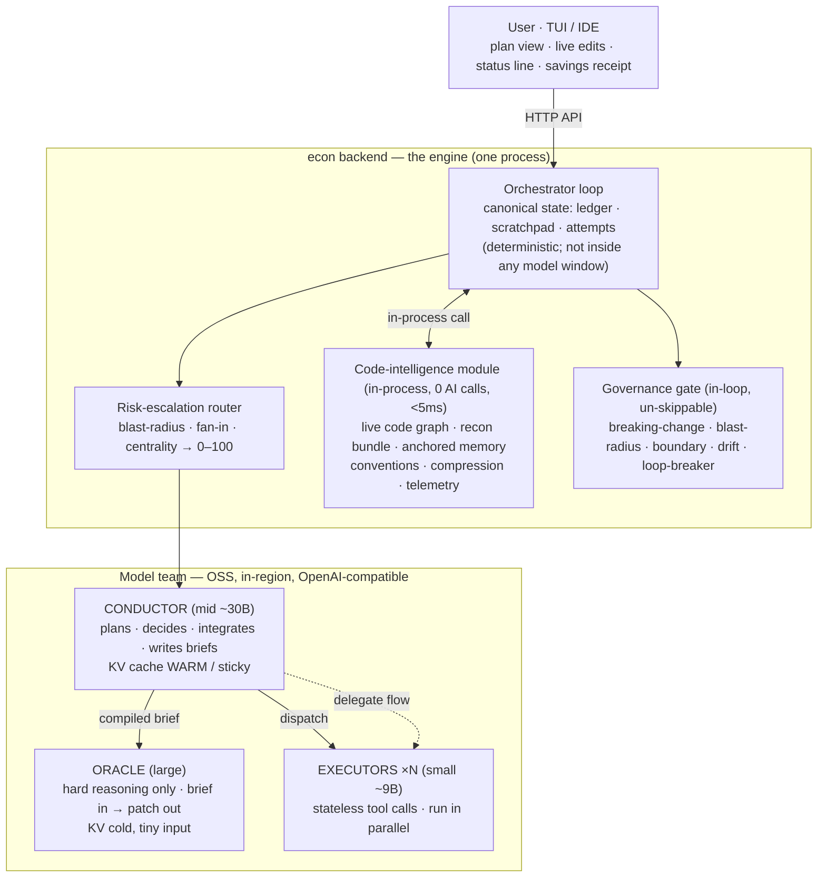

<p align="center">
  
</p>

<h1 align="center">econ</h1>

<p align="center">
  <strong>An economical coding agent — built for India, hosted in India.</strong>
</p>

<p align="center">
  A native coding agent that aims to match the capability of Claude Code / Cursor at a
  fraction of the running cost — by routing every step of the work to the cheapest
  open-source model that can do it well, and by handing the model only the slice of code
  that matters instead of the whole repo.
</p>

<p align="center">
  <a href="#build-run--develop">Build &amp; run</a> ·
  <a href="#architecture-at-a-glance">Architecture</a> ·
  <a href="#how-its-built-the-opencode-fork">How it's built</a> ·
  <a href="#the-economics">Economics</a> ·
  <a href="#roadmap">Roadmap</a> ·
  <a href="docs/architecture/ECON_ARCHITECTURE.md">Full design doc</a>
</p>

<p align="center">
  <sub>a coding agent by</sub>
  <br />
  <a href="https://github.com/unerr-ai"></a>
</p>

---

> **Status — engine transplanted, in active build.** econ is a fork of
> [OpenCode](https://github.com/anomalyco/opencode) (TypeScript/Bun, MIT) that we have
> taken over and into which we are transplanting a cost-routing engine and a native
> context-intelligence layer. The polished client/server shell + Go TUI are kept; the
> engine lands in the same-language backend. Built across sprints **S0–S8** (see
> [`docs/sprint*`](docs/)); proven today by an extensive unit/integration test suite with
> stub providers. **Not yet validated on a live in-region OSS-model deployment** — that
> and the production India hosting are the next milestones. This README describes what is
> built and where it is going; the per-sprint notes track the exact state.

---

## Why econ exists

Frontier coding agents are excellent and expensive, and most of that expense is **waste**
that has nothing to do with the hard part of coding:

1. **One model does everything.** The most capable (and most costly) "brain" gets used for
   boring mechanical work — fixing a test, renaming a symbol, formatting, "go find X" — the
   same way it's used for hard design and debugging. That's paying a senior engineer to do
   data entry.
2. **The agent reads too much.** It greps, reads whole files one at a time, and re-reads
   when the first read was too small — filling the context window (and the bill) with noise.
   Studies put **~84% of an agent's tokens in tool output**, mostly file reads.

econ removes both wastes natively, and adds a third thing the global tools don't prioritise:
a cost-efficient agent **native to the Indian market** — hosted in-region, defaulting to
open-source models that can be self-hosted or served cheaply locally, with data residency
and price points that fit local teams.

This matters more than ever. In 2026 two faults in the rent-one-frontier-API model became
impossible to ignore: it can be **switched off** for reasons unrelated to you (a sudden
global model suspension), and it is **expensive enough to drain a budget in a quarter**
(orgs hitting ~$2,000/developer/month and capping spend). A different cloud vendor fixes
neither; a self-hosted, multi-tier OSS team fixes both.

---

## The two beliefs everything is built on

> **Cost = tokens × price, not calls × anything.**

1. **Use the cheapest capable model for each step — not one model for everything.** A small
   "team" of models, each step routed to the cheapest tier that can do it well.
2. **Hand the model the right slice, not the whole repo.** Fewer, higher-signal tokens at
   every step is cheaper *and* more accurate — and it compounds with the cheaper models.

### The savings identity (stated honestly)

The thing that sets the bill is how many **tokens** — especially expensive output tokens and
re-sent context — touch the **expensive tier**. To first order:

> **cost reduction ≈ 1 − (the large model's share of total tokens)**

because the cheaper tiers are 100–200× cheaper per token and round to ~zero beside the large
one. So the entire engineering goal is: **keep tokens off the large model** — fewer
escalations, tighter briefs, capped output. We *count* savings from real usage data; we
don't promise them.

---

## Architecture at a glance

A **mid-tier conductor** drives every turn and holds the working context; a **large-tier
oracle** is consulted rarely, and only with a compiled brief; **small executors** do the
high-frequency tool work in parallel. All of it sits on a native, in-process
**code-intelligence layer** (live call graph, anchored memory, edit-time guardrails, output
compression) that hands each model the right slice.



**A turn, end to end:** ① a prompt arrives → anchored memory for the touched code is
injected; ② one recon call returns the relevant slices + callers + conventions (no fan-out
of file reads); ③ the router scores code-structural risk — low → the conductor proceeds,
high/abstain/triage → it compiles a brief and consults the oracle; ④ the conductor
dispatches tool calls to executors in parallel and/or delegates a known flow to a specialist
sub-agent; ⑤ before any edit lands, the **in-loop governance gate** fires (breaking callers,
blast radius, boundary, drift, loop-breaker) and fixes breaking changes in the same turn;
⑥ per-message usage flows to telemetry and the turn closes with a **savings receipt**.

### The model team

```
┌───────────────────────────────────────────────────────────────────────┐
│  ORCHESTRATOR LOOP  —  deterministic code (the engine)                  │
│  owns the canonical state: task ledger · scratchpad · what's been tried │
└───────────┬───────────────────────────────────┬────────────────────────┘
            │ default reasoning, every turn      │ escalate (compiled brief)
            ▼                                     ▼
   ┌──────────────────────┐            ┌────────────────────────────┐
   │  CONDUCTOR  (mid)    │            │  ORACLE  (large)           │
   │  ~30B, non-thinking  │            │  frontier / strongest OSS  │
   │  plans · decides ·   │  ────────▶ │  hard reasoning ONLY       │
   │  integrates · WRITES │            │  in:  compiled brief       │
   │  the brief           │            │  out: decision/plan/patch  │
   └──────────┬───────────┘            └────────────────────────────┘
              │ dispatches tight, stateless instructions
              ▼
   ┌───────────────────────────────────────────────┐
   │  EXECUTORS  (small) ×N — fan out in parallel    │
   │  ~9B tool-callers: slice in → tool call → out.  │
   │  No long context. Stateless.                    │
   └───────────────────────────────────────────────┘
```

**Why the mid tier drives, not the cheapest one.** A small model loses coherence over a long
agentic context — and because the re-sent transcript *is* the bulk of the tokens, putting it
on a model that derails wastes work and triggers escalations. Putting the *mid* tier in the
driver's seat keeps the small model on what it's reliably good at (single well-scoped tool
calls) and keeps the expensive model a consultant that never pays to carry context. The
**canonical state lives in the engine, not the model window** — so the conductor's window is
a *cache* of that state, refilled each step. This survives compaction, crashes, and tier
hops, and lets long jobs **checkpoint** (distil the run so far into a structured summary) and
keep going past a single context window.

### The router — escalate on *code risk*, not on the prompt

Most cheap routers guess difficulty from the text of the request. That is commoditized and
blind to the code. econ escalates on what a change would actually *do to the codebase*.

```
            ┌─────────────────────────────────────────────┐
   turn ──▶ │ compute risk score from the code graph        │
            │ (blast-radius · fan-in · centrality · cx)     │
            └───────────────┬─────────────────────────────-─┘
                            ▼
        score < 40 ──────────────────────────▶ CONDUCTOR handles it (cheap)
        40 ≤ score ≤ 70 ──▶ hysteresis: keep current tier (no flap)
        score > 70 ──┐
        OR verifier abstains ──┐
        OR triage: cheap won't pay ──┐
                                     ▼
                          build brief ─▶ ORACLE ─▶ integrate ─▶ continue
                          (record the double-pay in the receipt)
```

Two **hysteresis bands** (e.g. 70/40) stop one noisy reading from flapping the tier.
**Triage** only stays cheap when `cheapPassRate > 1 / interTierCostRatio` *and* the risk
signal actually discriminates. Every escalation is a **double-pay** (a cheap attempt *plus*
an oracle attempt) and is subtracted from the savings math so the numbers don't lie. Any
missing signal → **degrade open** to the cheap tier; routing is an optimization that must
never crash a turn.

### The context engine + governance gate

A live, in-process **code graph** (tree-sitter + verified call data) is the substrate: one
**recon** call returns a *bundle* — the relevant entities' bodies + their callers (blast
radius) + conventions + anchored memory — collapsing the search→read→search fan-out into one
round-trip. Output trimming and DOM-extracted web fetches keep the window dense with signal.

The **in-loop governance gate** fires **at the edit, inside the execution path, where it
cannot be skipped** — not an optional tool, not a review after the fact. Before a change
lands it surfaces every caller a signature change would break (and fixes them in the same
turn), flags boundary violations and convention slips, re-anchors memory as code moves, and
breaks retry doom-loops. Each check needs the edit *and* its dependents *and* the session
history at once — which is exactly why it's native to the engine, computed with **zero AI
calls per check**.

> For the full system design — KV-cache lifecycle per tier, the hook fire-points, the
> compiled-brief format, memory's four-moment lifecycle, the economics worked numerically,
> and the market/moat analysis — read
> [`docs/architecture/ECON_ARCHITECTURE.md`](docs/architecture/ECON_ARCHITECTURE.md).
> Compilable TikZ versions of the key figures live in
> [`docs/architecture/diagrams/`](docs/architecture/).

---

## How it's built — the OpenCode fork

We **transplant, we don't rebuild.** OpenCode gives us a nailed client/server split (a
Bun/Hono backend + a decoupled Go TUI over an HTTP API); we keep the shell and graft the
engine into the same-language backend at three kinds of seam:

| Zone | What it is | Where |
|---|---|---|
| **Z1 — Plugins / hooks** | Push-based behavior at turn lifecycle points (`tool.execute.before/after`, `context.assemble.before`) — no source fork needed | [`.opencode/plugins/econ-*.js`](.opencode/) |
| **Z2 — Inline intelligence** | The cost-routing engine + context-intelligence as an in-process module on `bun:sqlite` | [`packages/code-intelligence`](packages/code-intelligence) |
| **Z3 — Minimal source fork** | A handful of named seams in upstream code (the router fork, MCP permission hook, usage/cost mapping) | `packages/core`, `packages/llm`, `packages/opencode` |

**What's landed (S0–S8):**

- **`packages/code-intelligence`** — the engine: risk scoring + the risk-escalation router
  (`routeTurn`, hysteresis, abstention, triage, double-pay, compiled brief), specialists +
  fan-out planning, the governance gate (guardrail / edit-impact / boundary), anchored memory
  + conventions + decay + continuity, telemetry + savings receipt, long-horizon checkpoint /
  task-tree / goal-judge, and in-region tier/residency resolution. **473 tests, green.**
- **Router fork** in `packages/core/src/session/runner/model.ts` (`locationLayerWith`) — model
  selection becomes risk-driven with per-session hysteresis and degrade-open.
- **Tier wiring** in [`opencode.json`](opencode.json) — `conductor` (default, mid) / `oracle`
  (large) / `reasoner` (mid + CoT) / `executor` (small) as agents over OSS endpoints.
- **Hooks** in `.opencode/plugins/` — recon injection, output trimming, executor validation,
  the governance gate, the status line, and long-horizon checkpointing.
- **Observability** — per-message usage (tokens, `cache.read/write`, cost) → econ telemetry →
  status line + savings receipt, fed through a decoupled `globalThis` sink so the core never
  compile-depends on the observability layer.

> **Branding note.** The user-facing product name is **econ**; the underlying binary,
> package identifiers (`opencode`, `@opencode-ai/*`), the `.opencode/` config dir and
> `opencode.json` filename are intentionally kept verbatim — they are load-bearing for the
> build and runtime.

### Repository layout

```
packages/
  code-intelligence/   ← econ engine: router, risk, guardrails, memory, telemetry, receipt (Z2)
  core/                ← session runtime + the router fork (model.ts) + canonical state (Z3)
  llm/                 ← provider protocols + usage/cost mapping (Z3)
  opencode/            ← the product server/CLI binary (bun --compile target)
  tui/                 ← the Go TUI we keep
  sdk/ plugin/ cli/ …  ← upstream packages
.opencode/plugins/     ← econ-* lifecycle hooks (Z1)
opencode.json          ← tier/agent wiring + region config (our tracked product config)
docs/architecture/     ← the design: ECON_ARCHITECTURE.md, DECISION_AND_PLAN.md, IMPLEMENTATION_PLAN.md
docs/sprint0..8/        ← per-task build notes
```

---

## Build, run & develop

econ is a **Bun workspace** (`bun@1.3.14`, turbo monorepo). There is **no pnpm/npm** in the
tree — use Bun.

```sh
bun install                              # install dependencies (uses the patched deps in patches/)

bun turbo build --filter=opencode        # build the product server/CLI binary (per-platform, bun --compile)
bun turbo typecheck                       # typecheck the whole workspace
bun run lint                              # oxlint

# Tests run PER PACKAGE (the root bunfig blocks running tests from the repo root):
cd packages/code-intelligence && bun test     # the engine — 473 tests
cd packages/core && bun test test/session-canonical-state.test.ts
```

The compiled binary lands at `packages/opencode/dist/opencode-<platform>/bin/opencode`
(`--version` smoke-tests it). See [`CONTRIBUTING.md`](CONTRIBUTING.md) for the full dev loop
and conventions.

---

## The economics

Recall **reduction ≈ 1 − (large-tier token share)**. The conductor topology is built to shrink
that share: the token *bulk* (re-sent context) lives on the cheap mid tier, and the oracle
only ever sees small briefs. A representative split per 1M tokens of throughput:

| Tier | Token share | Price ($/M, blended) | Cost |
|---|---|---|---|
| Conductor (mid, holds context) | ~65% | ~$0.40 (self-hosted) | $0.26 |
| Executors (stateless tool calls) | ~25% | ~$0.05 | $0.01 |
| Oracle (small briefs, output-heavy) | ~10% | ~$20\* | $2.00 |
| **Total** | | | **~$2.27 / M** |

\* the oracle's brief is small *input* but its answer is *output*-heavy (output ≈ 5× input
price), which is why a 10% token share is ~88% of the bill.

Against a top-tier frontier model used for everything (blended ≈ $10/M), that's **~77%
reduction (≈4.4×)**; self-hosting the conductor and executors in-region drives the bill toward
the oracle alone, reaching **~85–90% (≈7–10×)**. The honest baseline is the frontier model
*with prompt caching*, so we quote the realistic **3–6×** before self-hosting — and the
savings receipt subtracts double-pay so the number reflects reality.

---

## Roadmap

| Phase | What lands | Topology state |
|---|---|---|
| **1 — Comparable core** | plan → edit → verify loop on OSS models | single capable tier (the conductor) |
| **2 — Context engine** | code graph, recon bundle, compression, optimal reads | the slice-delivery substrate |
| **3 — Routing** | risk-escalation router + the oracle as escalation target | **conductor + oracle** spine |
| **3b — Executors & specialists** | stateless executor tier + specialist sub-agent library | full **three-role** team |
| **3c — Long-horizon** | checkpointing + compaction for 100–200-step tasks | ultra-long jobs survive the window |
| **4 — Memory & guardrails** | anchored memory, conventions, in-loop governance gate | safety + cross-session continuity |
| **5 — Observability** | status line + savings receipt + unified telemetry | the proof surface |
| **6 — India hosting** | in-region inference + data residency | the market wedge |

**Also in scope (later):** **primitives** — a library of the smallest reusable,
production-ready code blocks (e.g. a SaaS starter with billing + login) the agent composes
rather than re-generates. We design the core to support primitives; we don't build them
before the core.

---

## Further reading

- [`docs/architecture/ECON_ARCHITECTURE.md`](docs/architecture/ECON_ARCHITECTURE.md) — the
  full system design + capability narrative (plain-language framing + "under the hood").
- [`docs/architecture/DECISION_AND_PLAN.md`](docs/architecture/DECISION_AND_PLAN.md) — why
  OpenCode, and the base-platform + build plan.
- [`docs/architecture/IMPLEMENTATION_PLAN.md`](docs/architecture/IMPLEMENTATION_PLAN.md) — the
  sprint-by-sprint plan (S0–S8).
- [`docs/sprint0`](docs/) … [`docs/sprint8`](docs/) — per-task build notes.
- [`CONTRIBUTING.md`](CONTRIBUTING.md) · [`SECURITY.md`](SECURITY.md)

---

## License & attribution

econ is built by **[unerr](https://github.com/unerr-ai)** and released under the
[MIT License](LICENSE). It is a fork of
[OpenCode](https://github.com/anomalyco/opencode) (© opencode / anomalyco, MIT); portions of
this software derive from OpenCode and that copyright notice is preserved in
[`LICENSE`](LICENSE). The cost-routing engine, context-intelligence layer, and the
integration are econ's own work.

<p align="center">
  <br />
  <a href="https://github.com/unerr-ai"></a>
  <br />
  <sub>built by <a href="https://github.com/unerr-ai">unerr</a></sub>
</p>
