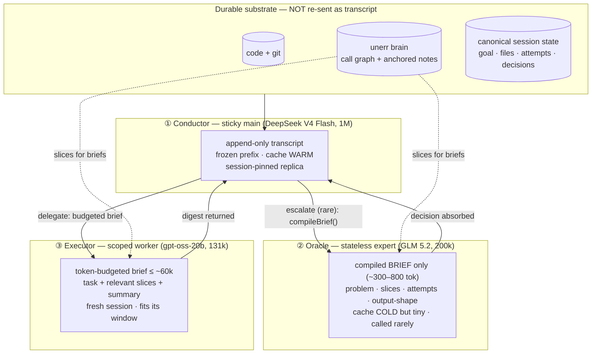
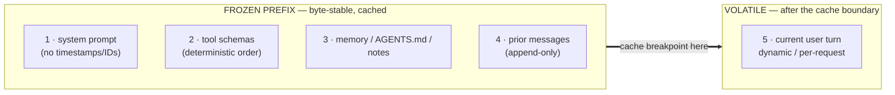
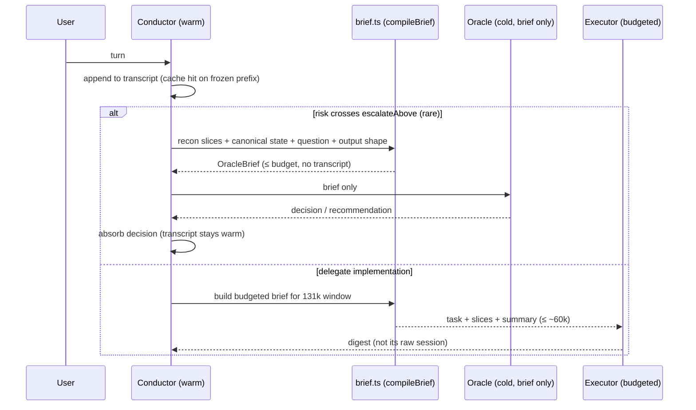
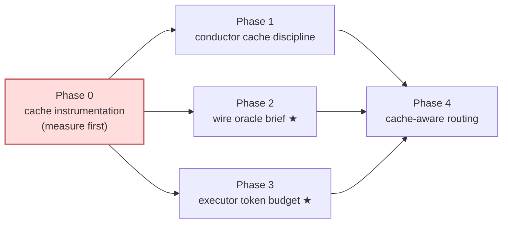

# Cross-Tier Context Sharing & Cache Strategy — Design + Implementation Plan

**Status:** Planning (design; one core module already exists, unwired). **Owner:** econ core.
**Scope:** How econ's three model tiers — conductor, oracle, executor — share context *without*
one giant shared transcript, keeping each model's prompt/KV cache as warm as possible, minimizing
cross-model transitions, and respecting the executor's smaller context window.

> **See also:** [`AUTO_COMPACTION_AND_CONTEXT.md`](./AUTO_COMPACTION_AND_CONTEXT.md) (what to do
> when *one* tier's window fills), [`models.md`](./models.md) (the tier/model facts),
> [`../features/03-risk-router.md`](../features/03-risk-router.md) (the escalation router that
> triggers a tier change), [`../features/06-observability.md`](../features/06-observability.md)
> (the savings/telemetry surface these metrics feed).
>
> Grounded in a read of the live code + a 2026 web sweep of prompt/KV-cache mechanics and
> multi-model handoff patterns. Constants (prices, thresholds) are as-reported — verify against
> the pinned provider docs before hard-coding.

---

## 1. The core truth (why "one shared context" is the wrong model)

econ runs **three different models**: conductor (**DeepSeek V4 Flash**, 1M ctx, the sticky
default), oracle/reasoner (**GLM 5.2**, 200k ctx, rare high-risk turns), executor
(**gpt-oss-20b**, 131k ctx, spawned per-task). A prompt/KV cache is **per-model / per-deployment
— it is never shared across different models** (confirmed across Anthropic, OpenAI, DeepSeek,
Fireworks, OpenRouter; cross-model reuse à la *DroidSpeak* needs identical architectures, which
our three don't share). So there is no "one context" that stays cached as we move between tiers.

That reframes the goal. "Share context without overwriting the KV cache" decomposes into three
independent objectives:

1. **Keep each model's *own* cache warm** across its consecutive turns — via a byte-stable,
   append-only prefix and sticky routing to the same serving replica.
2. **Minimize cross-model transitions** — every transition is a guaranteed cold cache; hysteresis
   and cache-affinity routing reduce how often we pay it.
3. **When we must cross, pass a small compiled brief, not the raw transcript** — a cold call on
   500 tokens is cheap; a cold call on a 200k transcript is not.

This is exactly the recorded topology decision (`dec p:`): **durable state lives in code + the
unerr brain; the sticky mid tier keeps its cache warm; the large/oracle tier is stateless and
fed a compiled brief, not the raw transcript.** This doc makes that decision concrete and closes
the gaps between it and the shipped code.

---

## 2. How econ shares context *today* (from a code read)

| Tier | Context it receives now | Cache | Gap |
|---|---|---|---|
| **Conductor** | The one accumulated session message array + system prompt (rebuilt each turn) + plugin-injected memory/recon. Order is stable: system → plugin ctx → tools → messages (`session/llm/request.ts`, ~L124-137). | **Warm across its own turns** (Fireworks/DeepSeek auto prefix cache) — *if* the rebuilt prefix stays byte-stable. | Prefix is **rebuilt per turn** — byte-stability is unverified (no golden-hash guard). |
| **Reasoner / Oracle** | On escalation the router (`code-intelligence/src/router.ts` `routeTurn`, dispatched in `core/session/runner/model.ts` ~L241-304) just returns a tier name → resolves the tier's agent → **re-sends the same full transcript to the new model.** | **COLD** every escalation (different model). And it re-sends a *large* transcript cold. | **The brief is not used here.** |
| **Executor** | Subagent spawned via the task tool; bootstrapped from a **message-count** subset (`SUBAGENT_BOOTSTRAP_LIMIT = 200` msgs / 80 calls, `cli/cmd/run/subagent-data.ts`), fresh child session. | Fresh session (cold, N/A). | **No token budget** — nothing sizes the child context to gpt-oss-20b's 131k window. |

**Two load-bearing findings:**

- **A token-budgeted brief compiler already exists but is unwired.** `packages/code-intelligence/src/brief.ts` — `compileBrief()` / `briefFromContext()` / `OracleBrief` — builds a budgeted brief (fixed sections: Problem / Question / Expected Output Shape, then greedily-allocated code slices, then prior attempts; `smartTruncate`; a tested "no raw transcript" contract). But `briefFromContext` has **only test callers** (verified via `get_references`) — it is **not wired into the escalation/oracle request path.** So today the oracle gets the cold raw transcript, exactly what the topology decision says it must not get.
- **Executor context is bounded by message count, not tokens.** Nothing consults `model.limit.context` (131k) when building the child prompt.

So econ is ~⅓ of the way there: sticky-ish conductor, a built-but-dark brief compiler, and no executor budgeter.

---

## 3. Target design — a per-tier context strategy

Three tiers, three distinct context contracts, one shared durable substrate.



### 3.1 Conductor — the sticky main (keep its cache hot)
- Owns the **canonical running transcript**. Every turn **appends** to it; never reorder/edit prior
  messages. This is the only tier that carries the full conversation.
- **Frozen, byte-stable prefix**, ordered `system → tools → memory → messages → (volatile last)`.
  The prefix must be identical bytes turn-to-turn so Fireworks/DeepSeek auto prefix-caching hits.
- **Sticky routing**: pin the session to one serving replica (`session_id` on OpenRouter,
  `x-session-affinity` on Fireworks) so the KV cache stays resident.
- DeepSeek's automatic disk cache + ~98% cache-read discount makes a warm conductor the cheapest
  possible default — the whole cost thesis leans on this staying warm.

### 3.2 Oracle — the stateless expert (brief, not transcript)
- Called **rarely** (high risk / hard step). Receives a **compiled brief only** — wire the
  existing `brief.ts`. No raw transcript, no session internals (the `OracleBrief` contract already
  enforces this).
- Its cache is **cold by design and that's fine**: a cold call on a few hundred tokens is cheap;
  the win is *never* sending it the big transcript cold.
- Returns a decision/recommendation the conductor absorbs into its (still-warm) transcript.

### 3.3 Executor — the scoped worker (budget to its window)
- Spawned per task. Receives a **token-budgeted brief sized to gpt-oss-20b's 131k window** with
  generation headroom (target payload ≈ 40–60k), assembled from: the task, the relevant code
  slices (from the unerr graph), the last error/attempt, and a short summary of prior turns.
- **Close the gap:** replace the message-count bootstrap with a token budget that consults
  `model.limit.context`.

### 3.4 The shared substrate (how context is "shared" without a shared prompt)
Context is shared through **durable state that any tier can read from**, not by replicating one
transcript into every model's window:
- **code + git** (ground truth), **the unerr brain** (call graph + anchored notes — the slices
  that populate briefs), and a **canonical session-state fragment** (goal, files touched, prior
  attempts, decisions). `briefFromContext` already consumes a `ReconBundle` + a
  `CanonicalStateFragment` — the substrate is the input to every brief.

---

## 4. Cache discipline (how to keep each tier's cache warm)

### 4.1 Prompt layout — frozen prefix, volatile last



Rules (each a task in §7):
- **No volatile tokens in the prefix** — timestamps, UUIDs, trace IDs, session IDs go in
  metadata/headers, never in the system prompt. *(Documented real case: a trace-ID in the system
  prompt dropped hit rate 94% → 11% in an hour.)*
- **Deterministic tool serialization** — fixed order + stable key order; never shuffle.
- **Append-only** message history; never reorder/edit prior turns.
- **Provider nuance:** on our OpenRouter→Fireworks/DeepSeek path caching is **automatic by prefix**
  — the discipline is *byte-stability + sticky routing*, not manual markers. The Anthropic-style
  explicit `cache_control` breakpoints (already present in `packages/llm/.../anthropic-messages.ts`)
  only apply if/when a tier routes to an Anthropic-family model.

### 4.2 Sticky routing (per session, per tier)
Pin each session's conductor to one replica so its KV cache stays resident (sticky routing raises
hit rate from ~60% round-robin to ~85–96% in published results). Pass `session_id` on OpenRouter
and `x-session-affinity` on Fireworks. Verify the same provider endpoint across consecutive turns.

### 4.3 Minimize transitions (each is a cold cache)
- Keep the router's **hysteresis** (hold the current tier in the mid risk band) so we don't flip
  tiers turn-to-turn.
- Prefer **cache-affinity**: don't bounce back and forth between conductor and oracle; batch the
  hard work while on the oracle if we've already paid the cold cost.

---

## 5. Handoff / brief flow



The conductor never ships its transcript sideways; it ships a **compiled artifact** sized to the
receiver. `brief.ts` already produces this for the oracle (unwired); the executor path needs the
same treatment with a window-aware budget.

---

## 6. Measuring it — cache-hit rate & friends

Instrument from day one; these numbers are also econ's savings-receipt fuel
([`../features/06-observability.md`](../features/06-observability.md)).

Per-turn, per-tier record:
```
{ turn_id, tier, model, session_id, provider_endpoint,
  input_tokens, cache_read_tokens, cache_write_tokens, output_tokens,
  cache_hit_rate = cache_read / (cache_read + cache_write + uncached_input),
  cost_total, brief_tokens?, transition_from? }
```

Targets & alerts (verify against our provider reality):
- **Conductor cache-hit rate target > 85%**; **< 70% is a bug** → diff the prefix hash, check
  sticky routing. (Published mature-agent baseline ~84%.)
- **Cross-model transition count per session** — track it; each transition is a cold cache.
- **Brief size** (oracle/executor) — alert if a "brief" exceeds its budget (means transcript leaked in).
- **Cost per tier** — conductor vs oracle vs executor, tied to the double-pay accounting already in
  `code-intelligence/src/double-pay.ts`.

**Guard against silent regressions:** a golden-hash CI check on the frozen prefix (system + tools)
that fails a commit which changes it without an explicit update — this is what catches an
accidental trace-ID or tool-reorder before it tanks the hit rate in production.

### Provider cache cheat-sheet (as-reported; verify)
| Provider (our use) | Cache type | Invalidated by | Cross-model? |
|---|---|---|---|
| **Fireworks** (serves our 3 via BYOK) | Automatic prefix, multi-tier | prefix mismatch | No |
| **DeepSeek** (conductor family) | Automatic disk, 64-tok units, ~98% read discount | non-matching prefix from tok 0 | No |
| **OpenRouter** (our gateway) | Pass-through; sticky-routes to cheaper-to-read provider | provider-specific | No (pins to one provider) |
| OpenAI | Automatic prefix (≥1024 tok, 128-tok blocks) | any prefix token change | No |
| Anthropic | Explicit `cache_control` breakpoints, 5-min TTL | any prefix change, tool/image change | No |

---

## 7. Implementation task tracker

Task IDs `CTX-<phase>.<n>` · `(tier, effort)` · rationale. Tier = executing sub-agent (worker =
scoped code; junior = recon/verify). **★ = closes a decision-vs-code gap.** Design/wiring stays
on the main thread.



**Phase 0 — Cache instrumentation (measure before optimizing).**
- [ ] **CTX-0.1** (junior, low) — confirm on the OpenRouter/Fireworks path whether responses report `cache_read`/`cache_write`; document the fields (ties the Day-0 cache-accounting gate).
- [ ] **CTX-0.2** (worker, med) — per-turn, per-tier cache-hit-rate + cost record; emit to telemetry (§6).
- [ ] **CTX-0.3** (worker, low) — track cross-model transition count per session.

**Phase 1 — Conductor cache discipline (keep the warm tier warm).**
- [ ] **CTX-1.1** (worker, med) — assert the conductor prefix is **byte-stable** turn-to-turn; golden-hash test over `system + tools`; CI fails on unflagged change. *Prefix is rebuilt each turn today — unverified.*
- [ ] **CTX-1.2** (junior, low) — audit the assembled prefix for volatile tokens (timestamps/IDs/session data); move any to metadata/headers.
- [ ] **CTX-1.3** (worker, low) — deterministic tool-schema ordering; assert stable serialization.
- [ ] **CTX-1.4** (worker, med) — sticky routing: pass `session_id` (OpenRouter) / `x-session-affinity` (Fireworks); verify same endpoint across turns.

**Phase 2 — Wire the oracle brief (★ close the topology gap).**
- [ ] **★ CTX-2.1** (main → worker) — wire `briefFromContext`/`compileBrief` into the escalation path so the oracle receives the **brief, not the raw transcript** (`core/session/runner/model.ts` + router). *brief.ts is built + tested but has only test callers.*
- [ ] **CTX-2.2** (worker, low) — feed the brief from the unerr `ReconBundle` + canonical state fragment (goal/files/attempts/decisions).
- [ ] **CTX-2.3** (junior, low) — assert the oracle request contains no raw transcript (extend the existing "no raw transcript" contract to the live path).

**Phase 3 — Executor token budget (★ respect 131k).**
- [ ] **★ CTX-3.1** (worker, med) — replace the message-count subagent bootstrap with a **token budget that consults `model.limit.context`** (131k for gpt-oss-20b), target payload ≤ ~60k.
- [ ] **CTX-3.2** (worker, med) — build the child context via select→compress (relevant slices from graph + summary of prior turns + last error), not a transcript copy.
- [ ] **CTX-3.3** (junior, low) — test: executor payload never exceeds its window; degrades gracefully if the task needs more (ask/scope down, don't overflow).

**Phase 4 — Cache-aware routing (minimize cold transitions).**
- [ ] **CTX-4.1** (worker, med) — keep/strengthen router hysteresis so tiers don't flip turn-to-turn; count avoided transitions.
- [ ] **CTX-4.2** (worker, low) — surface cache-hit-rate + transition cost in the savings receipt (per-tier).
- [ ] **CTX-4.3** (junior, low) — dashboard/alert: conductor hit-rate < 70% or a brief exceeding budget.

Sequencing: **0 first** (measure). Then **1/2/3 in parallel** — one sub-agent per phase. **4** last
(needs the metrics from 0 and the briefs from 2/3).

---

## 8. Risks & open questions

- **OpenRouter/Fireworks cache reporting** — if the provider doesn't surface `cache_read/write`
  honestly (the known OpenRouter bug), the hit-rate metric and the savings claim are both wrong.
  CTX-0.1 gates the rest — same Day-0 gate as compaction.
- **Prefix byte-stability is unverified today** — the conductor prefix is rebuilt per turn; if any
  step injects volatile bytes we're paying cold every turn without knowing. CTX-1.1/1.2 first.
- **Brief quality on a cheap oracle** — a too-terse brief starves GLM 5.2 of context; too-fat leaks
  the transcript. The `tokenBudget` + slice-ratio in `brief.ts` is the tuning surface; needs an eval.
- **Executor over-compression** — budgeting to 131k must not drop the one slice the task needs;
  pair with graph-driven slice selection, not blind truncation.
- **Open:** cross-model KV reuse (*DroidSpeak*) is out — our three models have different
  architectures. Revisit only if we ever standardize tiers on one backbone.
- **Open:** should the conductor→executor delegation reuse the oracle brief format, or a distinct
  executor-brief schema? Leaning shared `OracleBrief` shape with a larger budget; confirm in CTX-3.2.
