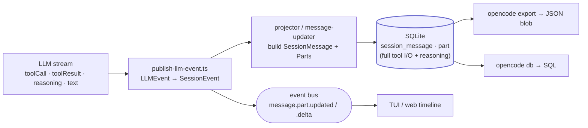

# Session record & transcript access

**Question this answers:** does econ keep a Claude-Code-style transcript — a durable
record of *everything that happened* in a session (user turns, assistant turns, tool
calls **and** their outputs, reasoning) that we can read back to understand a run — and
if so, can we improve it?

**Verdict: yes, and it is structurally richer than Claude Code's `.jsonl`.** econ (on the
OpenCode base) persists the full conversation — including every tool invocation, its full
output, and reasoning — to a structured, queryable SQLite store, with a live event stream
on top. What Claude Code has that we don't is *ergonomics*: a flat, line-delimited,
per-session file you can `tail -f`, `grep`, and `jq`. That gap is the improvement work
below — a thin read/stream layer over storage we already have, not a new data model.

> **Companion docs:** [`../features/06-observability.md`](../features/06-observability.md)
> owns the telemetry/savings *surface* (usage receipts, status line). This doc owns the
> raw *conversation record* (messages, parts, tool I/O) and how to read it back.
> [`AUTO_COMPACTION_AND_CONTEXT.md`](./AUTO_COMPACTION_AND_CONTEXT.md) §4.7/§6 rely on this
> record being complete (the DB retains the full head even after in-context compaction).

---

## 1. What exists today (inventory, with anchors)

Everything is persisted; nothing about the conversation is lost at the storage layer
(truncation happens only when feeding a model or rendering UI).

| Concern | Where | Anchor |
|---|---|---|
| Storage engine | **SQLite** (Drizzle ORM + Effect), WAL mode | `packages/core/src/database/database.ts:27-55` |
| On-disk path | `${xdgData}/opencode/opencode.db` — macOS `~/Library/Application Support/opencode/`, Linux `~/.local/share/opencode/`; overridable via `OPENCODE_DB` | `packages/core/src/global.ts:10-14`, `database.ts:43-55` |
| Message record | `session_message` table: `id`, `session_id`, `type`, `seq` (ordered per session), `time_created`, `data` (JSON) | `packages/core/src/session/sql.ts:118-137` |
| Message types | `user`, `assistant`, `system`, `synthetic`, `shell`, `agent-switched`, `model-switched`, `compaction` | `packages/core/src/session/message.ts:178-194` |
| Parts | `part` table (`PartTable.data` JSON) — one row per content part | `packages/core/src/session/sql.ts:81-97` |
| **Tool calls** | `ToolInvocation` union — `call` (name + `toolCallId` + input args), `partial-call` (streamed args), `result` | `packages/opencode/src/session/message.ts:11-62` |
| **Tool outputs** | `ToolResult.result` stores the **full** output as a string; `truncateToolOutput` trims only for display/compaction, *after* persistence | `packages/opencode/src/session/message.ts` · `message-v2.ts:54-58` |
| Reasoning | `ReasoningPart` (`type:"reasoning"`) persisted as first-class part | `packages/opencode/src/session/message.ts:51-56` |
| Live event bus | `message.updated`, `message.part.updated`, `message.part.delta`, `message.part.removed` published as parts stream in | `packages/opencode/src/session/message-v2.ts:60-75` |
| Event source | LLM events (`toolCall`, `toolInputStart/Delta/End`, `toolResult`, `toolError`) → SessionEvents → `PartUpdated` | `packages/core/src/session/runner/publish-llm-event.ts:75` · `packages/llm/src/schema/events.ts` |

### Access surfaces (CLI + UI)

| Command | Behavior | Anchor |
|---|---|---|
| `opencode export [id]` | Full session → **single JSON object** `{ info, messages[] }` to stdout; each message carries `parts[]` incl. tool `state.input`/`state.output`/`state.metadata`. `--sanitize` redacts text/paths/tool I/O | `packages/opencode/src/cli/cmd/export.ts:222-240` |
| `opencode import <file\|url>` | Re-populates the DB from an export blob or a share URL | `packages/opencode/src/cli/cmd/import.ts:83-225` |
| `opencode session list` | Metadata only (`id`, `title`, timestamps, `directory`) — table or JSON. **No `get`/`show`** to dump one session's messages | `packages/opencode/src/cli/cmd/session.ts:44-148` |
| `opencode db "<sql>"` | sqlite3 shell / one-shot query → JSON or TSV. `SELECT * FROM session_message WHERE session_id=? ORDER BY seq` is the raw transcript | `packages/opencode/src/cli/cmd/db.ts:8-62` |
| `Session.share()` | Publishes to a share URL (consumed by `import`) | `packages/core/src/v1/session.ts:528` |
| Web timeline | `MessageTimeline` re-renders all parts (incl. tool calls/results) from the DB on resume | `packages/app/src/pages/session/timeline/message-timeline.tsx:238+` |

---

## 2. econ's record vs Claude Code's `.jsonl`

```
Claude Code                              econ (OpenCode base)
─────────────────────────────           ─────────────────────────────────────
per-session flat file:                   one SQLite DB for all sessions:
  ~/.claude/projects/<cwd>/<id>.jsonl      ~/…/opencode/opencode.db
append-only, 1 JSON object / line        structured tables (session_message, part)
  → tail -f / grep / jq per line           → SQL queries, richer, transactional
records msgs + tool_use + tool_result    records msgs + tool call+result + reasoning
  (full)                                   (full output in storage; trim = display only)
plain text = the source of truth         DB = source of truth; live event bus on top
resume reads the file                    resume reads the DB; web timeline re-renders
```

**Where we already win:** structured & queryable (SQL, not line-grep), transactional,
full tool I/O + reasoning preserved, a real-time event stream, and export **/** import
**/** share round-trips. Claude Code's file is just newline-JSON.

**Where Claude Code is more ergonomic (the gaps to close):**

1. **No per-session plain-text file.** Everything is inside one binary SQLite DB — you
   can't `tail -f`, `grep`, `jq`, `diff`, or `git`-track a single run without going
   through `db`/`export`.
2. **Export is one big JSON object, not JSONL.** A 400-turn session is a single blob you
   must parse whole; you can't stream it, `head` it, or append to it incrementally.
3. **No `session show`/`session get` CLI.** To read a run back you must hand-write SQL
   (`db`) or export the whole thing — there's no "print this session as a readable
   transcript" command.
4. **No live tail.** The event bus exists, but nothing exposes `session tail <id>` to
   follow a running session's tool calls/results from another terminal or a log file.
5. **No on-disk audit log.** Nothing writes a durable, human-readable trail per session
   for debugging/post-mortems independent of the DB.

None of these need a schema change — the data is all there. They are a **read/stream
layer** over existing storage.

---

## 3. Persistence flow (what's already wired)



The dashed pieces below (§4) attach to `DB` (read commands) and `BUS` (live tail / audit
sink) — no change to the write path.

---

## 4. Improvement plan (read/stream layer — no schema change)

Pseudocode only, per repo convention. Tier = executing econ sub-agent
(worker = scoped code; junior = recon/verify/docs; main = design/wiring). `TR-x`.
**★ = parity feature Claude Code users expect.**

**Phase 0 — Read a session back as a transcript (fills the biggest gap).**
- [ ] **★ TR-0.1** (main → worker) — `opencode session show <id>` command. Fetch messages
  ordered by `seq`, render a readable transcript (role headers, tool call → args → result,
  reasoning foldable). Flags: `--json`, `--format=jsonl|text|md`, `--tools=full|summary`,
  `--tail=N`. *Reuses the export fetch path; no new storage.*
  ```
  show(id, opts):
      msgs = db.select(session_message).where(session_id=id).orderBy(seq)
      for m in msgs:
          parts = db.select(part).where(message_id=m.id).orderBy(order)
          emit(render(m, parts, opts))   # text | md | one JSON object per line (jsonl)
  ```
- [ ] **★ TR-0.2** (worker, med) — **JSONL export mode**: `opencode export --format=jsonl`
  emits one JSON object per message (Claude-Code-shaped: `{type, role, parts|tool_use|tool_result, ts}`),
  streamed, so `head`/`grep`/`jq`/append all work. Keep the existing single-object JSON as default.
- [ ] **TR-0.3** (junior, low) — document the raw SQL recipe (`SELECT … session_message …`)
  and the DB path in [`../../HOW_IT_RUNS.md`](../../HOW_IT_RUNS.md) so power users can query directly.

**Phase 1 — Live tail (parity with watching a run).**
- [ ] **★ TR-1.1** (worker, med) — `opencode session tail <id>` (or `--follow` on `show`):
  subscribe to `message.part.updated`/`.delta` on the event bus and stream tool calls +
  results to stdout as they happen. *Bus already emits these; this is a subscriber.*
  ```
  tail(id):
      for evt in bus.listen(["message.part.updated","message.part.delta"]):
          if evt.session_id == id: emit(renderPart(evt.part))
  ```
- [ ] **TR-1.2** (worker, low) — optional on-disk **audit sink**: a plugin (same seam as
  `econ-status.js`) that appends each part-updated event to `<project>/.opencode/logs/<id>.jsonl`.
  Off by default; gives a durable, greppable, git-ignorable trail for post-mortems.

**Phase 2 — Ergonomics & econ-specific enrichment.**
- [ ] **TR-2.1** (worker, low) — tag each assistant turn in the transcript with the **tier
  that produced it** (conductor/oracle/executor) + per-turn cost, sourced from the telemetry
  `UsageEvent` ([`../features/06-observability.md`](../features/06-observability.md)). Turns
  a transcript into a routing/cost audit — a differentiator Claude Code's flat file lacks.
- [ ] **TR-2.2** (junior, low) — redaction parity: reuse `export --sanitize` field markers in
  `session show`/`tail` so a shared/pasted transcript is safe by the same rules.
- [ ] **TR-2.3** (worker, low) — `--since <seq|time>` / `--grep <pat>` filters on `session show`
  so you don't dump a 400-turn run to find one tool call.

**Sequencing:** TR-0 first (it closes the "I can't read a run back without SQL" gap with a
command that reuses the export fetch path). TR-1 (live tail) and TR-2 (enrichment) then fan
out in parallel — one sub-agent each. All of it is additive over existing storage + bus; no
migration.

---

## 5. Testing

- **TR-0.1/0.2:** round-trip — `show --format=jsonl | wc -l` equals message count; each line is
  valid JSON; tool call + result pair reconstructs from the lines; `--tail=N` returns the last N.
- **TR-0.2 shape:** a JSONL export re-imports (or a documented converter maps it back to the
  `{info,messages}` blob) so nothing is a one-way street.
- **TR-1.1:** drive a live session with `bun run dev`; a second `session tail` process prints each
  tool call/result within one event of it landing; no dropped/duplicated parts.
- **TR-1.2:** audit sink file is append-only, one JSON object per line, and matches the DB record.
- **TR-2.1:** tier + cost annotations on each assistant turn match the telemetry ledger for that turn.

---

## 6. Risks & notes

- **Don't fork the write path.** Every task here reads from `DB` or subscribes to `BUS`. The
  moment a "transcript" feature starts *writing* its own copy, it can drift from the DB — keep
  the DB the single source of truth and treat files as derived views.
- **Large tool outputs.** Full outputs live in storage; a `text`/`md` `session show` should
  summarize+offer-full (like the UI) so a single `read` of a huge file doesn't flood the terminal —
  but `--tools=full` and `--format=jsonl` must emit the untruncated stored output.
- **Sanitization is opt-in on export today.** Any new *shareable* surface (TR-1.2 audit file,
  pasteable `show`) must default to the same `--sanitize` markers or clearly warn it is raw.
- **Open:** whether to persist the JSONL audit file per-project (git-ignorable, close to the work)
  or under the global data dir next to the DB. Leaning per-project for TR-1.2 (matches how devs
  expect logs), global for anything canonical.
