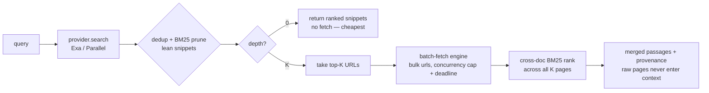

# Tooling & context-optimization

**Status:** proposal + audit + implementation log (in progress) · **Date:** 2026-06-30 · **Owner:** econ core

econ's context-engineering pillar has three parts, covered here in one place: **collapse
the native tool surface** so the model sees a small, unambiguous set; make every tool's
**output** lean by default (budgets, ranking, `cache_ref` pagination) — the first-order
token lever, since uncached per-turn output dominates cost over the cached schema prefix;
and **port the proven `../unerr-cli` compression/graph/fetch capabilities** that already
solve this problem in the reference implementation. Part III is the gap matrix that feeds
Part IV's sprint log — the sprint tasks mirror the port-backlog items nearly one-to-one, so
each capability below is described once: its parity-gap origin, then its as-built outcome.

**Structure:** **I)** Tool-surface consolidation (~19 → ~12) · **II)** Tier-aware
prompts/instructions · **III)** Reference-parity gap matrix (vs. `../unerr-cli`) · **IV)**
Implementation sprint log + as-built outcomes.

---

# I. Tool-surface consolidation (~19 → ~12)

Goal: collapse the agent's ~19 native tools into a **finer set** where each tool does more
and returns less. Context optimization should be **automatic and built into the tool
layer** — not something the model has to remember to ask for. This is the "hand the model
the right slice, not the whole repo" pillar, applied to the tools themselves.

## Two different token costs (lead with the right one)

There are two places tools spend tokens, and they are NOT equally expensive:

| Cost | Where it lives | Cached? | When paid |
|---|---|---|---|
| **Tool *schema*** (id + description + JSON params) | system-prompt prefix | **Yes** — stable prefix → cache-read | once, then cache-discounted |
| **Tool *output*** (what a call returns) | per-turn message stream | **No** — fresh every turn, re-fed into context next turn | every call, **compounding** |

**Implication.** Merging tools shrinks the cached prefix — a real but cache-discounted
win. The dominant cost is **tool output**, which is uncached and snowballs as the
transcript grows. Our savings model (`reduction ≈ 1 − large_token_share`) is driven by
token volume, so **output leanness is the first-order lever; tool-count reduction is
second-order** (it still matters: fewer tools = smaller prefix + fewer wrong-tool calls +
less model confusion).

**Priority order for this work:**
1. Make every tool's **output** lean by default (budgets, ranking, truncation + pagination).
2. **Merge** overlapping tools so the surface is small and unambiguous.
3. **Gate** experimental/rare tools out of the default set.

## Current inventory (~19 tools)

Source: `packages/opencode/src/tool/registry.ts` + `packages/opencode/src/tool/<name>.ts`.

| Tool | Group | Notes |
|---|---|---|
| `read` | code read | line-numbered file read; image/PDF sniff; ~100 KB trunc |
| `graph_file_read` | code read | file/entity read off in-process graph (econ S1.2) |
| `grep` | code search | ripgrep regex, ~5000-match cap |
| `glob` | code search | ripgrep file-name glob, ~100 cap |
| `recon` | code search | task-phrase → entities + callers + notes bundle (econ S1.2) |
| `getReferences` | code search | callers/callees via call graph (econ S1.2) |
| `edit` | code edit | exact-span replace; fuzzy/Levenshtein; `replace_all` |
| `write` | code edit | create/overwrite; auto-format |
| `patch` | code edit | unified-diff apply; **GPT-models-only** swap-in for edit/write |
| `shell` | exec | run command, capture+truncate output |
| `webfetch` | web | fetch + HTML→Markdown, 5 MB cap |
| `webfetchCompress` | web | BM25-ranked passages (econ S2.3) |
| `search` | web | Exa/Jina web search; provider-gated |
| `task` | loop | delegate to junior/worker/senior subagent |
| `todo` | loop | record action items (SQLite) |
| `skill` | loop | load + invoke a saved skill |
| `question` | loop | ask the user; client-gated |
| `lsp` | loop | LSP queries; **experimental flag** |
| `plan` | loop | plan-mode exit; **experimental, CLI-only** |

The overlap is obvious: **3 ways to read code, 4 ways to search it, 3 ways to edit it, 3
ways to touch the web.**

## Consolidated set (as built, Sprint 6)

**Net advertised set after Sprint 6: ~12 tools.** The consolidation realized via
**in-place swaps** (names kept, body swapped) and **fold + hide** (names retire,
capability absorbed into a unified tool). Sprint 6 shipped with this pragmatic approach:
`read`, `webfetch`, `search`, `file_outline`, `edit`, `write`, `bash`, `task`, `todowrite`,
`skill`, `question` (+ internal `invalid`). The original proposal below (shown for
reference) described a more aggressive target (`navigate`, `web`, `edit`, 7 core); Sprint 6
used in-place + fold instead of renaming to reach 12.

**Advertised set (Sprint 6 as built):**

| Tool | Replaces | Shape |
|---|---|---|
| **`search`** | `search_code`, `recon`, `grep`, `glob`, `get_references` | Single find/search tool spanning indexed code + raw text/filenames. `{query, mode?: "task"\|"symbol"\|"literal"\|"regex"\|"glob"\|"refs", ...}`. Default `task` returns the recon bundle. Graph-first; literal/regex/glob fall back to ripgrep for non-indexed reach. Subsumes the 4 hidden tools. |
| **`read`** | `read`, `graph_file_read` | `{path, entity?, offset?, limit?, token_budget?}`. Entity-aware (one function) or ranged file; graph metadata when `entity` given. Raw fallback when not in graph. |
| **`webfetch`** | `webfetch`, `webfetch_compress` | `{url\|urls?, prompt?, offset?, limit?, token_budget?, cache_ref?}`. Repointed to the compressed engine (BM25 passages, pagination, metadata). Always returns pruned passages, never raw HTML. |
| **`file_outline`** | — | `{path}`. Structure + imports/exports of a file. |
| **`edit`** | `edit`, `write` (optionally `patch`) | `{path, old_string?, new_string?, content?, replace_all?}`. Patch strategy chosen internally per model. |
| **`bash`** | `shell` | `{command, timeout?, run_in_background?}`. Output truncation tightened (see Part IV). |
| **`task`** | `task` | Delegation primitive — unchanged. |
| **`todowrite`** | `todo` | Write/track todos — conditional. |
| **`skill`** | `skill` | Load saved skills — unchanged. |
| **`question`** | `question` | Client-gated — unchanged. |

**Hidden (executable, not advertised):**

| Tool | Why |
|---|---|
| `recon` | Folded into `search` default (task bundle). |
| `get_references` | Folded into `search mode:refs`. |
| `grep` | Folded into `search mode:literal\|regex` + ripgrep fallback. |
| `glob` | Folded into `search mode:glob` (filesystem scan). |

**Original proposal (first draft, shown for reference, now superseded):**

| Proposed tool | Subsumes | Shape |
|---|---|---|
| **`navigate`** | `recon`, `grep`, `glob`, `getReferences` | one entry point for "find/understand code": `{query, mode?: "task"\|"symbol"\|"regex"\|"refs", ...}`. Default `task` returns the recon bundle. Graph-first; regex/glob fall back to ripgrep for non-code text. |
| **`read`** | `read`, `graph_file_read` | `{path, entity?, offset?, limit?, budget?}`. Entity-aware (one function) or ranged file; graph metadata when `entity` given. |
| **`edit`** | `edit`, `write`, `patch` | `{path, old_string?, new_string?, content?, replace_all?}`. Patch strategy chosen **internally** per model — not a separate tool the model sees. |
| **`shell`** | `shell` | unchanged; output truncation tightened. |
| **`web`** | `webfetch`, `webfetchCompress`, `search` | `{action: "fetch"\|"search", url?\|urls?\|query?, prompt?, depth?, offset?, limit?, token_budget?}`. **Always compressed** (BM25-ranked passages) — raw-HTML fetch retired. `fetch` supports **bulk `urls[]`** (cross-doc ranking). `search` is **token-pruned** (BM25 snippets, lean shape, dedup) and takes a **`depth`** knob: `0` = ranked snippets only; `K` = auto-fetch top-K + prune across pages, returning only relevant passages (raw pages never enter context). Search-fusion reuses the batch-fetch engine — see Part III §3. |
| **`task`** | `task` | unchanged; the delegation primitive. |
| **`skill`** | `skill` | unchanged; loads saved skills. |
| **`question`** *(conditional)* | `question` | client-gated, as today. |
| **`todo`** *(conditional)* | `todo` | keep only if the loop relies on it; otherwise fold into agent state. |

**Net (proposed):** ~19 → **7 core (+2 conditional)**. The four overlapping families each
collapse to one tool with a `mode`/`action` discriminator.

## Automatic context optimization (the built-in part)

Every tool ships these defaults so the model gets a lean slice without asking:

- **Default token budget per call.** Each tool caps its output (e.g. `read` ~2 KB default,
  `search` top-K ranked, `bash` head+tail with middle elided). The model can raise it
  explicitly; it never has to lower it.
- **Rank, don't dump.** `search` and `webfetch` return **BM25-ranked passages** against the
  query, not raw content. Relevance first, volume never.
- **Truncate + paginate via `cache_ref`.** Oversized results are truncated and return a
  handle; follow-up pages come from cache (no recompute, no re-read of the whole thing).
  Pagination cost ≈ zero. (Primitive defined in Part IV, Sprint 0.3.)
- **Structured > prose.** Tools return `{structured, content}`; the structured half lets
  the loop act without re-serializing text into the next prompt.
- **Graph-first reads.** Code navigation goes through the in-process graph (entity-scoped)
  before it ever falls back to whole-file reads — the single biggest output-token saver for
  code work.

These are the mechanism behind "context optimization happens automatically."

## Removed / gated

| Tool | Disposition | Why |
|---|---|---|
| `grep`, `glob` | **folded into `search`; hidden** (Sprint 6.3–6.5 — DONE) | `search mode:glob` already is a filesystem scan (covers `glob` today); ripgrep fallback on `mode:literal\|regex` covers `grep`'s non-indexed reach. Both kept executable (HIDDEN) for back-compat; scrubbed from prompts. |
| `recon`, `get_references` | **hidden** → `search` (default / `mode:refs`) | graph-redundant with `search` modes; executable as before, not advertised. |
| `graph_file_read` | **absorbed into `read` in-place** (Sprint 6.1 — DONE) | `read` gains graph/entity reads + raw fallback; no read-before-edit gate to break (verified). |
| `search_code` | **renamed to `search`** (Sprint 6.0 — DONE) | The tool now spans indexed code + raw text + filenames (grep/glob folded in), so the `_code` suffix no longer fits. |
| `write`, `patch` | folded into `edit` — **deferred** (Part D) | touches model-swap logic; revisit later |
| `webfetch` | **kept; body swapped to the compressed engine in-place** (Sprint 6.2 — DONE) | name stays; raw-HTML impl replaced by BM25-ranked passages (absorbs `webfetch_compress`). |
| `webfetch_compress` | **absorbed into `webfetch`** (Sprint 6.2 — DONE) | was a parallel duplicate; its engine becomes `webfetch`'s body. |
| `lsp` | **gated off** the default set (experimental flag) | rare; large schema; not worth prefix cost by default |
| `plan` | **gated off** the default set (experimental, CLI-only) | mode-specific; not a general tool |
| `todo` | **conditional** | keep only if the loop depends on it |

Gated tools still exist behind flags — they just don't sit in every request's prefix.

## Migration & backward-compat

Tool IDs are a **model-facing contract** (agents, skills, and saved prompts call them by
name). Consistent with the S0.8 decision that rebrands are display-only and identifiers
stay verbatim, we **do not hard-rename**:

- New canonical tools are added; **old IDs become aliases** that forward to the new tool
  with a preset `mode`/`action` (e.g. `grep` → `navigate({mode:"regex"})`).
- The per-model `edit`/`write`↔`patch` swap in `registry.ts` becomes **internal strategy
  selection inside `edit`**, removing a model-conditional branch from the registered
  surface.

### De-register, then delete (disposition of the old tools)

A tool only costs tokens if it's in the **exposed** set. `registry.ts` already has the
seam: `Service.all()` (every implemented tool) vs `Service.tools(model)` (the filtered list
actually serialized into the prompt, registry.ts:289-301). A tool whose `.ts` exists but is
excluded from `tools(model)` contributes **zero tokens** — the model never reads it. So we
don't delete to save tokens; we **de-register**. Two phases:

- **Phase 1 — de-register (ships 100% of the token win, reversible).** Expose only the new
  tools in `tools(model)`. Keep old IDs as a **non-exposed dispatch map** (old-id → new tool
  + preset mode) applied at the *tool-call handler*, not in the registered schema list — so
  a saved skill/prompt that still emits `grep` is transparently routed to
  `navigate({mode:"regex"})` **without `grep` ever appearing in the model's tool list**. (An
  alias only costs tokens if exposed; this one isn't.) Old implementation files stay on disk
  behind the filter — a regression is a one-line filter flip, not a code restore.
- **Phase 2 — delete (housekeeping, after the new set proves out).** Once nothing
  references the old IDs — audit skills, prompts, tests, and the generated tool-usage block
  (Part II) — delete the dead `.ts` files. This buys maintenance simplicity only; the token
  savings were already captured in Phase 1.

**Rule of thumb:** the model reads exactly what the filter exposes — that's the lever.
Deleting code is downstream of de-registration, never a prerequisite.

## Expected impact

- **Prefix:** ~19 → ~7 tool schemas in the cached system prompt — smaller prefix,
  cache-discounted but real; also fewer wrong-tool calls (less model confusion).
- **Output (the big one):** default budgets + BM25 ranking + `cache_ref` pagination cut the
  uncached, compounding output stream — the term that actually moves `reduction ≈ 1 −
  large_token_share`.
- **Maintenance:** one code-search path, one read path, one edit path, one web path —
  easier to optimize once and benefit everywhere.

---

# II. Tier-aware prompts & instructions

## Instruction surface inventory

Source: `packages/opencode/src/session/{system.ts, instruction.ts, llm/request.ts}` and
`packages/opencode/src/session/prompt/*.txt`. Assembly happens in `request.ts:prepare()`.

| Surface | Where | Size | Always/cond. | Notes |
|---|---|---|---|---|
| **System prompts** | `session/prompt/*.txt` (13 files) | **~135 KB total**; one selected per request | always | 8 provider variants: anthropic, beast (gpt-4/o1/o3), gpt, codex, gemini, kimi, trinity, default |
| **Prompt selector** | `system.ts:24-38` `provider()` | — | always | switches on `model.api.id` (claude/gpt/gemini/…) — **provider, not tier** |
| **Environment block** | `system.ts:54-89` | ~0.2–0.5 KB | always | model/cwd/git/platform/date — **re-injected per turn (uncached)** |
| **Skills list** | `system.ts:92-104` | 0–2 KB | if skill perm on | formatted skill descriptions |
| **Custom instructions** | `instruction.ts:60-68` | 1–10 KB | if files exist | AGENTS.md / CLAUDE.md / CONTEXT.md, walked up tree |
| **Tool descriptions** | per-tool `.description` | ~5–15 KB filtered | always | prose **hardcodes tool names** (read/grep/glob/…) |
| **Mode prompts** | `plan*.txt`, `build-switch.txt` | 0.2–4.4 KB | by mode | plan vs build |
| **Per-agent prompt** | `request.ts:60-65` | varies | if `agent.prompt` set | overrides provider default entirely |
| **Plugin injections** | `request.ts:69-96` | varies | if plugins | `chat.system.transform`, `context.assemble.before` (recon/memory) |

**Typical per-request system block: 20–60 KB.**

### Audit findings

1. **Prompt sprawl / drift risk.** 13 near-duplicate monoliths, ~135 KB. A single
   behavioral change (or a tool merge) must be mirrored across 8 variants by hand —
   guaranteed drift.
2. **Written for frontier models.** anthropic.txt / beast.txt / gpt.txt assume strong
   instruction-following. Neither of our actual default consumers — the **mid-32B
   reasoner** nor the **stateless large oracle** — is the audience. The 32B likely needs
   *tighter, more scaffolded* instructions; the oracle needs a *compiled brief*, not 8 KB of
   conversational system prose.
3. **Tool names hardcoded in prose.** Prompts name `read`/`write`/`edit`/`grep`/`glob`
   directly. Part I's merge silently invalidates them → the model is told to call tools
   that no longer exist. **Hard coupling — must change in lockstep.**
4. **Selection is provider-keyed, not tier-keyed** (`system.ts:24-38`). No path gives the
   large tier a brief instead of the full prompt, or gives the 32B a variant tuned for it.
   This is the biggest structural gap.
5. **Cached vs per-turn not separated.** The big `.txt` core is stable → cached prefix
   (cheap, and we *want* it sticky for mid-tier cache warmth). The environment block +
   reminders re-inject **uncached** every turn — that's the line item to squeeze, mirroring
   Part I's output-vs-schema logic.
6. **Redundancy.** System prompt, tool descriptions, and CLAUDE.md overlap (e.g. "prefer
   graph tools over grep" lives in several places). Dedupe to one source of truth.

## Instruction upgrade plan

Ordered by leverage, same philosophy as Part I (per-turn/uncached first, sticky-prefix
second).

1. **Single source of truth for the tool-usage section.** Stop hardcoding tool names in
   prompt prose. **Generate** the "available tools / how to use them" block from the
   registered tool set (the Part I registry) at prompt-assembly time. A tool merge then
   updates every prompt automatically — closes finding #3 permanently. *(This is the
   concrete tie-in: do it as part of the Part I merge.)*
2. **Layered prompt model — shared core + thin tier/provider deltas.** Replace 8 monoliths
   with: one **core** (role, tool-usage-generated, safety, output contract) + small
   **deltas** per provider quirk + per econ tier. Compose at build/request time. Kills
   finding #1's drift; shrinks total maintained text.
3. **Add tier-role selection alongside provider** (`system.ts` `provider()` →
   `select(model, tier, mode)`):
   - **mid-32B default reasoner:** explicit, scaffolded, example-driven variant; keep it
     **sticky** so the cache stays warm (per orchestrator topology).
   - **large stateless oracle:** **compiled brief**, not the full system prompt — task +
     compiled context only, per the topology decision (durable state lives in code + unerr
     brain, not in a fat prompt). This is a new assembly path, not just a smaller `.txt`.
   - **junior:** minimal read-only-flavored variant.
4. **Split cached core from per-turn injection.** Freeze the stable core in the cached
   prefix; audit the environment block + any per-turn reminders for bloat and trim to the
   minimum that must refresh each turn (finding #5).
5. **Dedupe across system prompt / tool descriptions / CLAUDE.md** (finding #6) — one
   statement of each rule; remove instructions that contradict the new tool set (e.g.
   anything steering the model to `grep` instead of `navigate`).
6. **Rebrand prose only, identifiers verbatim.** Per the S0.8 decision, prompt *prose* may
   say "econ", but tool IDs, paths, commands, and `opencode.json`/`.opencode/` tokens
   embedded in prompts stay verbatim — they're contracts, not display strings.
7. **Measure.** Token-count each assembled prompt before/after; run an
   instruction-following spot-check on the mid-32B for the tightened variants (a shorter
   prompt that the 32B follows *worse* is a regression, not a win).

### Sequencing with Part I

| Step | Depends on |
|---|---|
| Tool merge (Part I) | — |
| Generated tool-usage block (§10.1) | tool merge (needs the final registry) |
| Layered core + deltas (§10.2) | generated block |
| Tier-role selection + oracle brief (§10.3) | layered core; orchestrator wiring |
| Cached/per-turn split + dedupe (§10.4–5) | layered core |

The two efforts share one principle and one registry: **the tool set is the single source
of truth, and the prompt is generated from it — not maintained in parallel.**

## Open questions

**Tools (Part I):**
1. Does collapsing `grep`/`glob` into `navigate` modes hurt the model's ability to pick the
   right search? (Mitigate: clear mode docs + sane default.)
2. Right **default token budget** per tool — needs measurement against real transcripts,
   not a guess.
3. Keep `todo`, or move action-items into durable agent state (per the orchestrator
   topology: durable state lives in code + unerr brain)?
4. Should `task` results also be BM25-compressed before re-entering the parent context?
   (Subagent digests are a major output-token source.)

**Instructions (Part II):**
5. How much of the frontier-model prompt does the **mid-32B** actually need vs. what
   should be rewritten tighter? Only measurement on the 32B answers this.
6. **Compiled-brief format for the oracle** — what exactly goes in (task + compiled
   context), and who compiles it (the mid-tier reasoner? a dedicated step)? Ties directly
   into orchestrator wiring.
7. Build-time vs request-time prompt composition — composing at request time is flexible
   but adds latency and can break **prefix-cache stickiness**; build-time keeps the prefix
   frozen. Likely build-time core + minimal request-time tail.
8. Do any provider variants (kimi/trinity/gemini) carry must-keep quirks, or can they
   collapse fully into core + a 1–2 line delta?

---

# III. Reference parity — the unerr-cli port backlog

`../unerr-cli` is the **proven reference implementation** of the context-engineering
tools. econ ported the *foundations* but, in three areas, not the *optimization layers*
that actually drive token savings. This section is the gap matrix + prioritized port
backlog that **feeds Part IV** — the consolidated tools (`search`/`read`/`webfetch`/`edit`/
`bash`) must absorb these ports as part of the merge, not re-skip them.

**Headline verdict:** econ has the *bones* of every tool, but was missing unerr-cli's three
optimization stacks — (1) the **shell compression** layer, (2) the **graph intelligence**
layer (notes/signals/modes), and (3) the **fetch production** layer
(pagination/metadata/batch). These are exactly the *uncached, per-turn output* reductions
that move `reduction ≈ 1 − large_token_share` — so they are first-order savings work, not
polish. Part IV records what has since shipped against each gap below.

## 1. Shell — the floor vs. the compression layer

econ `shell` (`packages/opencode/src/tool/shell.ts` + `truncate.ts`) matched unerr-cli only
on the basics. The whole compression stack was the gap (ported in Part IV, Sprint 1).

| Capability | unerr-cli `exec` | econ `shell` (pre-port) | Gap |
|---|---|---|---|
| 50 KB / 2000-line caps, ANSI strip, head/tail, timeout/abort | ✓ | ✓ | — |
| **Command classification** (`COMMAND_HINTS`, 500+ entries → category) | ✓ | ✗ | **yes** |
| **Per-category compressors** (11 strategies) | ✓ | ✗ generic truncation only | **yes** |
| Tabular column-pruning (`ps`/`ls`/`docker ps`/`kubectl get`) ~60–75% | ✓ | ✗ | **yes** |
| Test-result extraction (jest/pytest/cargo/go) ~70–85% | ✓ | ✗ | **yes** |
| `git status` dedicated parser ~70–85% | ✓ | ✗ | **yes** |
| Log dedup / pattern extraction | ✓ | ✗ | **yes** |
| `stderr` merge for ~30 compile/test cmds (tsc/cargo/pytest/eslint) | ✓ | ✗ | **yes** |
| Graph-aware diff compression (preserve high-fan-in hunks) | ✓ | ✗ | **yes** |
| Compression metrics / SQLite logging | ✓ | ✗ | low |

**unerr-cli source:** `src/proxy/shell-compressor.ts`, `shell-classifier.ts`,
`shell-strategies/*` (tabular, test-results, log-text, diff, git-status,
error-diagnostic, structured, …), `shell-graph-boost.ts`.

**"Broad command coverage"** = `COMMAND_HINTS` special-cases git, docker/podman,
kubectl/helm, pnpm/npm/yarn/cargo/go/mvn/gradle/dotnet, jest/vitest/pytest/rspec,
terraform, aws/gcloud/vercel/fly, psql/mysql/sqlite, ps/ls/df/top, etc. — each routed to a
category compressor.

**Port target:** lift `shell-compressor` + `shell-classifier` + `shell-strategies/` into
econ behind the existing `shell` tool (post-process the captured output before
truncation). Self-contained; no model-facing surface change. → executed as **Part IV,
Sprint 1**.

## 2. Graph tools — `search` consolidated, intelligence layer remains

econ's graph tools (`packages/opencode/src/tool/graph-tools.ts` →
`packages/code-intelligence/src/{tools,bun-sqlite-graph}.ts`) have the graph foundation and
are consolidated as follows (per Part I / Part IV Sprint 6):
- **`search_code` → `search`:** Renamed and unified with grep/glob/recon/get_references
  modes. Task / symbol / literal / regex / glob / refs.
- **`recon` + `get_references` hidden:** Now folded into `search` as default and
  `mode:refs`; executable but not advertised.
- **`graph_file_read` absorbed into `read`:** Entity-aware reads now live in the `read`
  tool.

The foundational capability exists; the **optimization layers** (notes, signals,
intelligence) were the remaining gap (ported in Part IV, Sprint 2):

| Capability | unerr-cli | econ (pre-port) | Gap |
|---|---|---|---|
| Entity reads, callers/callees, BunSqliteGraph | ✓ | ✓ | — |
| **`recon` bundle carries anchored notes** (`kind\|anchor\|polarity\|content`) | ✓ | ✗ `notes:[]` stub | **yes (high)** |
| Conventions + domain-tag (`@sem`) awareness in bundle | ✓ | ✗ minimal | yes |
| **`ur\|<tag>` signal protocol** (act/ctx/rsk/fct) | ✓ | ✗ | **yes (high)** |
| `search` **symbol** search (name/partial/key) | ✓ | ✗ task-phrase only | **yes (high)** |
| `search` **literal/regex** content mode + context lines | ✓ | ✓ | — |
| `search` detail flags (`include_body`, `want`, `kind`) | ✓ | ✗ | yes |
| **`file_outline` tool** (structure + imports/exports) | ✓ | ✓ | — |
| `search` `include_text_occurrences` (rename mode, from `get_references`) | ✓ | ✗ | **yes (med)** |
| `search` `limit` | ✓ | ✓ | — |
| **`cache_ref` pagination** (hash → ~1ms cached slice) across read tools | ✓ | ✗ full recompute | **yes (med)** |
| `token_budget` / consistent naming | ✓ | ✓ | — |
| `scope:'workspace'` cross-repo federation | ✓ | ✗ | low |

**unerr-cli source:** `src/proxy/tool-definitions.ts`, `tool-descriptions.ts`,
`src/tools/coding/{file-read,file-outline}.ts`.

**Port target (ordered):** (a) enrich the `search` recon bundle with anchored notes +
conventions + `ur|` signals; (b) add `search` symbol mode (name/partial/key); (c) `search`
`include_text_occurrences` (rename mode); (d) `cache_ref` pagination as a shared read-tool
primitive. → executed as **Part IV, Sprint 2**.

## 3. Web — batch-fetch, metadata, and the search↔fetch fusion design

econ `webfetch` + `websearch` (`packages/opencode/src/tool/{webfetch,websearch}.ts`).

### Fetch

| Capability | unerr-cli `fetch_url` | econ `webfetch` (pre-port) | Gap |
|---|---|---|---|
| HTTP fetch, 5 MB cap, heading-split passages | ✓ | ✓ | — |
| BM25 ranking | ✓ full (stopwords, link-density, heading weight) | ✓ basic | partial |
| **Bulk `urls:[...]` in one call + cross-doc ranking + provenance** | ✓ (1–10 URLs, 5 concurrent) | ✗ | **yes (high)** |
| **`offset`/`limit` pagination** | ✓ | ✗ | **yes (high)** |
| **Metadata** (OG tags, author, published_at, site_name) | ✓ | ✗ | **yes (high)** |
| `token_budget` truncation | ✓ | ✗ | yes |
| Robust DOM extraction (Readability + Defuddle + fallback) | ✓ | ✗ regex/turndown | yes |
| SPA/JS rendering (Playwright optional) | ✓ | ✗ | **won't build** — see decision below |
| Anti-bot rescue (Cloudflare/hCaptcha detect → Playwright) | ✓ | ✗ | **won't build** — see decision below |
| Retry + typed errors (http/blocked/dns/deadline) | ✓ | ✗ single attempt | med |
| Quality signals (`playwright_rescued`, `inflated`) | ✓ | ✗ | n/a (no Playwright) |
| Hash cache | ✓ etag/conditional-get | ✓ in-memory | low |

### Search

| Capability | unerr-cli | econ `websearch` | Note |
|---|---|---|---|
| Web search tool at all | ✗ **none** | ✓ Exa + Parallel | **econ-only capability** |
| Params (`numResults`, `type` auto/fast/deep, `livecrawl`, context cap) | — | ✓ rich | keep |
| Result reranking / dedup | — | ✗ | gap |
| **Snippet token-pruning** (BM25 vs query, not raw char cap) | — | ✗ `contextMaxCharacters` raw truncation | **gap — econ-only opportunity** |
| **Lean result shape** (drop raw html/redundant fields) | — | ✗ | gap |

**unerr-cli source:** `src/tools/web/{fetch-url-protocol,bm25-rank,extract,passage-split,spa-render,anti-bot,post-process}.ts`.

**Why unerr-cli never optimized search — and why econ can.** unerr-cli is an MCP **proxy**:
web search is the *host's* tool, so unerr-cli could only pass it through or replace it
wholesale — it never owned a search backend to optimize. econ owns `websearch.ts` (direct
Exa/Parallel) end-to-end, so search is ours to token-optimize *and* to fuse with fetch. This
is a genuine econ-only lever, not a port.

**Search token-optimization (econ-owned).** `websearch` returned provider results roughly
as-is, truncated by `contextMaxCharacters` (~10k raw chars). Upgrades, all on our side of
the wire:

- **BM25-prune each result's text against the query** instead of a blind char cap — keep
  the relevant passages, drop the rest. Same engine as fetch.
- **Lean result shape:** `{title, url, ranked_snippet, score, published_at?}` — drop raw
  HTML and redundant provider metadata before it ever hits context.
- **Dedup** near-identical results (same canonical URL / domain+title).
- **Denser default:** fewer results (top ~5 ranked) with higher signal beats 8 raw
  snippets; expose `token_budget` consistent with fetch.

### Search ↔ fetch fusion (the key design decision)

Question: when search returns results, should we auto-fetch + prune some/all and return
**only pruned info**, instead of handing the model raw snippets and making it fetch
separately?

**Decision: one `web` tool with a `depth` knob — fused, not two round-trips.**

| `depth` | Behavior | Cost | Use |
|---|---|---|---|
| `0` (snippets) | token-optimized ranked snippets only, no fetch | cheapest | discovery / "what's out there" |
| `K` (default ~3) | search → **auto-fetch top-K in parallel** → BM25-prune **across all K pages** → return merged passages + per-source provenance; **raw pages never enter context** | one call replaces search+pick+fetch×K | "find the answer to X" (the common case) |

- **Some, not all, at once:** fetch the **top-K by relevance** (default ~3, cap ~5), **in
  parallel** with a concurrency cap + deadline — *not* all 8 results (diminishing return,
  real latency/cost). K is tunable per call.
- **Only pruned information is used:** the fetched pages are compressed to query-relevant
  passages server-side; the model sees passages + sources, never raw HTML. This is the
  token win — raw page bodies are discarded before context.

**The elegant part — it reuses the fetch batch engine.** Fused search is literally
*batch-fetch seeded by the top-K search URLs*: search → take K URLs → hand them to the bulk
`urls[]` + cross-doc BM25 pipeline (the P1 fetch port). Build the batch primitive once;
search-fusion and multi-URL fetch are two callers of it. No separate machinery.



**Port/build target:** (1) build the **batch-fetch + cross-doc BM25** primitive (shared
engine); (2) port fetch **pagination → metadata** onto it; (3) add the **search
token-pruning** (lean shape + BM25 snippets + dedup); (4) wire **`depth` fusion** on top —
search feeds K URLs into the batch engine. → executed as **Part IV, Sprint 3**.

### Decision: SPA render + anti-bot rescue — not building it (2026-06-30)

Verified against the Claude Code reference source (`../claude-code-source-code`): it ships
**zero** browser automation — its WebFetch is `axios` + Turndown + an Anthropic
domain-blocklist check; no Playwright/Puppeteer/jsdom render path. And our search providers
**Exa + Parallel crawl + extract JS pages server-side**, so the SPA/anti-bot problem is
handled upstream of econ. A brittle, resource-heavy headless tier for a problem our paid
providers already solve is exactly the cost econ exists to cut.

**Only residue worth keeping:** an optional, low-priority **domain-safety guard** on the
direct-URL fetch path (blocklist + refuse cross-origin redirect) — an SSRF guard, security
not token-opt; not scheduled.

**Web search backend.** Provider stays Exa + Parallel (hosted search APIs via MCP
JSON-RPC; user funds the keys). Config is env-var only, no code change: `EXA_API_KEY` (Exa
— key in URL query, `https://mcp.exa.ai/mcp`), `PARALLEL_API_KEY` (Parallel —
`Authorization: Bearer`, `https://search.parallel.ai/mcp`), `OPENCODE_WEBSEARCH_PROVIDER=exa|parallel`
(optional; default is a deterministic 50/50 session-hash split). Keep these `OPENCODE_*`
names verbatim (S0.8).

## 4. Unified port backlog (prioritized across all three)

Ranked by token-savings impact (P0 = biggest `1 − large_token_share` mover).

| # | Item | Area | Why it ranks here |
|---|---|---|---|
| **P0** | Shell compression stack (classifier + 11 strategies + git-status + stderr-merge) | shell | Every agent run shells constantly; 60–85% off the highest-volume uncached output |
| **P0** | `search` bundle intelligence (anchored notes + `ur\|` signals + conventions) | graph | Unlocks active-cognition; without it the brain is decorative |
| **P1** | `search` symbol + literal/regex modes + detail flags | graph | Core navigation; today agents over-read whole files |
| **P1** | **Batch-fetch + cross-doc BM25 engine** (bulk `urls`) | web | The shared engine; powers both multi-URL fetch *and* fused search; 5–10× multi-URL win |
| **P1** | **Search↔fetch fusion** (`depth` knob: snippets vs auto-fetch+prune top-K) | web | Collapses search+pick+fetch into one call; raw pages never enter context — biggest web-side token win (econ-only) |
| **P2** | Web fetch: pagination + metadata (on the batch engine) | web | Provenance + page-walking |
| **P2** | **Search token-pruning** (lean shape + BM25 snippets + dedup) | web | econ owns search; replace raw `contextMaxCharacters` cap |
| **P2** | `cache_ref` pagination as a shared read-tool primitive | graph+web | Kills full-recompute re-reads everywhere |
| **P2** | `file_outline` tool + `get_references` text-occurrences | graph | Targeted drill-down; safe renames |
| **P3** | Graph-aware diff compression in shell | shell | Needs daemon graph; high value on big diffs |
| **P4** | Compression metrics/telemetry; workspace scope; charset/host rules | all | Observability + federation polish |
| ~~SPA render + anti-bot rescue~~ | ~~web~~ | **DROPPED** — providers crawl+extract server-side; Claude Code ships zero browser automation (see decision above) |
| (opt) | Domain-safety guard on direct-URL fetch (blocklist + no cross-origin redirect) | web | Low-pri SSRF guard from Claude Code; security, not token-opt |

**Web build order (one engine, three callers):** batch-fetch+BM25 engine → { pagination+
metadata fetch, search token-pruning, `depth` fusion } all sit on top of it. Don't build
search-fusion as separate machinery — it's the batch engine seeded by search URLs.

**How this feeds Part IV:** the new tools in Part I are the **landing site** for these
ports — done as part of the merge, not after: `shell` absorbs the P0 compression stack;
`search`/`read` absorb recon-bundle intelligence, search modes, `file_outline`, `cache_ref`;
`webfetch`/`websearch` absorb pagination + metadata + batch + fusion. Net: consolidation
makes the surface *smaller*; the parity ports make each surviving tool *as lean and capable
as the proven unerr-cli original*. Same principle both halves of this doc share — the
savings live in the output, and unerr-cli already solved most of the output compression;
Part IV is the record of transplanting it.

## Caveats

- unerr-cli paths above were read from `/Users/jaswanth/IdeaProjects/unerr-cli` at audit
  time; confirm against HEAD before porting (file layout may have moved).
- Some unerr-cli optimizations (graph-aware diff/git-status risk boost) depend on the
  `unerrd` daemon graph being available — gate them on daemon presence, same as unerr-cli
  does.
- Per the S0.8 decision, when porting, prose/branding may become "econ" but identifiers,
  tool IDs, command tokens, and import paths stay verbatim.

---

# IV. Implementation sprint log + as-built outcomes

**Top priority, by explicit direction: token optimization + context pruning.** Everything
else (the structural merge, instruction regen) waits behind it. The parity reference for
every port is Part III above; each task below names the exact `../unerr-cli` source it
lifts from.

## Governing principles

1. **Optimize-in-place, merge later.** Compression/pruning ports (Sprints 1–3) land on the
   *existing* tools (`shell.ts`, `webfetch-compress.ts`, `graph-tools.ts`). They ship token
   savings the day they merge — **no dependency on the structural consolidation** (Sprint
   4). The merge then inherits already-optimized internals.
2. **Prune at the source, never in the model.** Unwanted data (passing-test noise, raw HTML
   chrome, full file bodies, redundant table columns) is removed **before** the result
   enters context. The model never sees, then discards.
3. **Impact order = token volume.** In a coding agent: shell output and code reads dominate
   token volume; web is occasional. So shell → graph → web by impact — but they touch
   disjoint files and are **parallelizable** after Sprint 0 (one `unerr-worker` per sprint).
4. **Prove every claim.** No compressor merges without a before/after token ratio on the
   benchmark corpus (Sprint 0). A port that doesn't measurably cut tokens is not done.
5. **Ground in unerr-cli; gate graph-dependent features.** Where a unerr-cli optimization
   needs the `unerrd` daemon graph (diff/git-status risk boost), gate on daemon presence
   exactly as unerr-cli does.

### Dependency map

```
Sprint 0 (contract + token meter + cache_ref) ── gates everything
        │
        ├── Sprint 1 (shell compression)      ┐
        ├── Sprint 2 (graph pruning + recon)  ├─ parallelizable, disjoint files
        └── Sprint 3 (web engine + fusion)    ┘
                       │
              Sprint 4 (structural merge + de-register)
                       │
              Sprint 5 (instruction regen + phase-2 delete)
```

## Sprint 0 — Shared contract, token meter, cache_ref primitive

**Goal:** the scaffolding that makes pruning measurable and reusable. Small but gating —
without the meter we can't prove savings; without `cache_ref` the graph and web sprints
each reinvent pagination.

| Task | What | Ground in unerr-cli | Up/downstream |
|---|---|---|---|
| **0.1 Token meter** | per-tool-call accounting: `raw_tokens`, `returned_tokens`, `ratio`; log to telemetry | `src/proxy/shell-compression-log.ts` (metrics + SQLite pattern) | **down:** feeds savings receipt (`emitSavingsEvent`) — the observability product surface |
| **0.2 Output contract** | standardize every tool to `{structured, content, meta:{raw_tokens, returned_tokens, cache_ref?}}` + a uniform `token_budget` param | unerr-cli tool-definition param conventions (`tool-definitions.ts`) | **down:** all Sprint 1–3 tools emit it; instruction regen reads param names |
| **0.3 cache_ref primitive** | content-hash → reversible cache; `{offset, limit}` returns a withheld slice in ~1ms; miss recomputes | unerr-cli hash-based reversible cache (used across `file-read.ts`, `fetch-url-protocol.ts`) | **down:** shared by graph reads (S2) + web fetch (S3) |
| **0.4 Benchmark corpus** | capture real shell/fetch/recon outputs from sample sessions; freeze as fixtures | — (econ-side harness) | **down:** the pass/fail gate for every compressor |

**Pseudo-code — cache_ref (shared by all read/fetch tools):**
```
function emitWithCacheRef(inputs, computeFull, offset, limit, budget):
    key = hash(inputs)                      # url+prompt+topK, or path+entity+range
    full = cache.get(key) or cache.put(key, computeFull())
    slice = full[offset : offset+limit]     # or budget-bounded
    return { content: slice,
             meta: { cache_ref: key, total: len(full),
                     more: offset+limit < len(full) } }
# next page: caller passes cache_ref → cache.get(key), no recompute
```

**Exit:** every tool reports a compression ratio; a second page of any result costs ~0
recompute. Owner: `unerr-worker` (scaffold) + main-thread review.

## Sprint 1 — Shell output compression (P0, highest token volume)

Addresses the shell gap in Part III §1. **Goal:** transplant unerr-cli's shell compression
stack behind econ's existing `shell` tool — the biggest single uncached-output win (60–85%
on the highest-frequency tool). All grounded in `../unerr-cli/src/proxy/shell-*`.

**Upstream change:** `shell.ts` must surface **raw stdout AND stderr separately** to the
compressor (today they're handled together) — the stderr-merge step (T1.4) needs both.
**Downstream:** compressed output + ratio → token meter (0.1); nothing else changes (same
tool ID, same call shape).

| Task | What | Ground in unerr-cli | Tier |
|---|---|---|---|
| **1.1 Classifier** | port `COMMAND_HINTS` (500+ cmd→category) + `classifyShellOutput` → `{category, confidence}` | `shell-classifier.ts` | worker |
| **1.2 Strategy dispatcher** | `applyStrategy(category, confidence)`; below confidence threshold → `omni` fallback | `shell-compressor.ts` (`applyStrategy`) | worker |
| **1.3 High-value strategies** | port **tabular** (column-prune), **test-results** (summary+errors), **git-status** (parser), **log-text** (dedup) first | `shell-strategies/{tabular,test-results,git-status,log-text}.ts` | worker |
| **1.4 stderr merge** | for ~30 compile/test cmds (tsc/cargo/pytest/eslint…), fold stderr→stdout before classify; dedup | `shell-compressor.ts` (`shouldMergeStderr`) | worker |
| **1.5 Remaining strategies** | diff, error-diagnostic, structured, yaml, key-value, progress, tree-paths | `shell-strategies/*` | worker |
| **1.6 Graph risk boost** *(gated)* | annotate `git status`/diff files with fan-in; preserve high-risk hunks | `shell-graph-boost.ts` | worker, **gate on daemon** |

**Pseudo-code — shell compression pipeline (post-capture, pre-return):**
```
raw = capture(cmd)                          # stdout + stderr held separately
if cmd in STDERR_MERGE_SET:                 # T1.4
    raw = dedup(merge(raw.stdout, raw.stderr))
clean = stripAnsi(raw)
(category, conf) = classify(cmd, clean)     # T1.1: COMMAND_HINTS
out = conf >= 0.7 ? STRATEGY[category](clean, budget)   # T1.2/1.3/1.5
                  : omni(clean, budget)                 # fallback
if daemonGraph: out = riskAnnotate(out)     # T1.6, gated
return { content: out, meta: ratio(raw, out) }   # → token meter
```

**Exit:** on the corpus, ratios within ~5% of unerr-cli for tabular / test / git-status; no
command's *signal* (error lines, failing test, diff hunk) lost to truncation. **Verify**
via `unerr-junior` run against the corpus.

## Sprint 2 — Graph reads: pruning first, intelligence second (P0/P1)

Addresses the graph gap in Part III §2. **Goal:** make code navigation lean (the
second-highest token sink) and revive the stubbed recon intelligence. Token-pruning tasks
(2.1–2.3) rank above the capability tasks (2.4–2.6). Grounded in
`../unerr-cli/src/proxy/tool-definitions.ts`, `src/tools/coding/{file-read,file-outline}.ts`,
and the recon bundle composition.

**Upstream:** anchored notes need a store — wire `packages/code-intelligence`
(`bun-sqlite-graph.ts`) to persist/serve notes by anchor. **Downstream:** recon notes +
`ur|` signals are consumed by the agent loop; lean index feeds the instruction regen (fewer
tool-output tokens to describe).

| Task | What | Ground in unerr-cli | Priority |
|---|---|---|---|
| **2.1 Lean index by default** | recon/search return signatures + line-ranges + caller-counts, **not full bodies**; bodies withheld behind `cache_ref` | `tool-definitions.ts` (lean index contract) | **pruning P0** |
| **2.2 cache_ref on reads** | wire 0.3 into `file_read`/recon so withheld bodies page in at ~0 cost | `file-read.ts` | **pruning P0** |
| **2.3 file_outline tool** | structure + import/export list, so agents drill instead of reading whole files | `file-outline.ts` | **pruning P1** |
| **2.4 recon bundle intelligence** | populate the empty `notes:[]` — anchored notes (`kind\|anchor\|polarity\|content`), conventions, domain tags | recon composition in `tool-definitions.ts` | capability P1 |
| **2.5 ur\|<tag> signals** | emit act/ctx/rsk/fct lines on graph responses | unerr-cli signal protocol | capability P1 |
| **2.6 search_code modes + refs** | symbol search, literal/regex+context, detail flags (`include_body`/`want`/`kind`); `get_references` `include_text_occurrences` + `limit` | `tool-definitions.ts` | capability P1 |

**Pseudo-code — lean-index + cache_ref read (the pruning core):**
```
result = graph.recon(task)                  # entities, callers, notes
for e in result.entities:
    e.preview = signature + firstNLines(e, 15)   # NOT full body
    e.body_ref = cache.put(e.key, fullBody(e))   # withheld
return { structured: result, meta: budgeted(result) }
# agent reads one body later via read({entity, cache_ref}) — pays only for that one
```

**Exit:** a recon call returns the same *navigational* information at a fraction of tokens
(no full bodies); `notes:[]` is populated; renames can find text occurrences. Owner:
`unerr-worker`; recon-bundle wiring reviewed on main thread.

## Sprint 3 — Web: one engine, three callers (P1)

Addresses the web gap and the search↔fetch fusion design in Part III §3. **Goal:** build
the batch-fetch + cross-doc BM25 **engine** once, then hang fetch pruning, search pruning,
and `depth` fusion off it. Grounded in `../unerr-cli/src/tools/web/*`. (econ keeps its own
`websearch` — unerr-cli has none — but now token-optimizes it.)

**Upstream:** provider clients (Exa/Parallel for search; HTTP for fetch). **Downstream:**
fewer round-trips (fusion collapses search+pick+fetch into one); ratio → token meter.

| Task | What | Ground in unerr-cli | Order |
|---|---|---|---|
| **3.1 BM25 ranker** | port full ranker (stopwords, link-density filter, heading weight) — replace econ's basic BM25 | `bm25-rank.ts` | first |
| **3.2 Extraction + passaging** | Readability/Defuddle + raw-body fallback; heading-aware split — replace econ regex extraction | `extract.ts`, `passage-split.ts` | first |
| **3.3 Batch engine** | `urls[]` (1–10), concurrency cap + deadline, cross-doc BM25, per-passage provenance (`source_index`/`source_url`) — **the shared engine** | `fetch-url-protocol.ts` (`runFetchUrlBatch`) | core |
| **3.4 Pagination + metadata** | `offset`/`limit` (via 0.3) + OG/article metadata (author, published_at, site_name) on the engine | `fetch-url-protocol.ts`, `post-process.ts` | on engine |
| **3.5 Search token-pruning** | BM25-prune snippets vs query (not raw char cap), lean shape `{title,url,ranked_snippet,score}`, dedup | econ-owned; reuse 3.1 ranker | on engine |
| **3.6 depth fusion** | `depth:0` = pruned snippets; `depth:K` = seed top-K search URLs into 3.3, return only cross-doc-ranked passages | econ-owned; composes 3.3 + 3.5 | on engine |

**Pseudo-code — depth fusion (search seeds the batch engine; see diagram in Part III §3):**
```
hits = provider.search(query)               # Exa/Parallel
hits = dedup(hits); hits = prune(hits, query, budget)   # T3.5 lean+BM25
if depth == 0:
    return { structured: leanSnippets(hits) }           # cheap discovery
urls = topK(hits, depth)                                 # some, not all
passages = batchFetchAndRank(urls, query, budget)        # T3.3 — the engine
return { structured: passages,                           # only pruned info
         sources: urls,                                  # provenance
         meta: ratio(rawPages, passages) }               # raw pages discarded
```

**Exit:** a multi-URL fetch and a `depth:K` search each return cross-doc-ranked passages
(raw pages never in context); `websearch` snippets are BM25-pruned, not char-capped.
Owner: `unerr-worker`; fusion contract reviewed on main thread.

**Dropped — SPA render + anti-bot rescue (was 3.7).** Not building it; see the decision
and reasoning under Part III §3 ("Decision: SPA render + anti-bot rescue"). Sole scheduled
residue: an optional, low-priority domain-safety guard on the direct-URL fetch path.

## Sprint 4 — Structural consolidation + de-registration

**Goal:** now that internals are optimized, collapse ~19 tools → 7 core (+2) per Part I, and
stop exposing the old ones. Pure surface change; low risk because the behavior already
lives in the optimized tools.

| Task | What | Ground / seam |
|---|---|---|
| **4.1 `navigate`** | merge recon/grep/glob/getReferences under a `mode` discriminator | Part I; econ `graph-tools.ts` + ripgrep fallback |
| **4.2 `read`** | merge read/graph_file_read; entity-aware; `cache_ref` | Part I |
| **4.3 `edit`** | merge edit/write/patch; patch becomes internal per-model strategy | Part I; `registry.ts` edit/patch swap |
| **4.4 `web` finalize** | unify fetch/search/`depth` behind one tool | Part I + Sprint 3 |
| **4.5 De-register** | expose only new tools in `tools(model)`; **non-exposed** old-id→new dispatch map | `registry.ts:289-301` (Part I §"De-register, then delete", Phase 1) |
| **4.6 Gate/decide** | `lsp`/`plan` off default set; resolve `todo` keep-or-fold | Part I §"Removed / gated" |

**Exit:** model sees a lean tool set; old IDs still work via `all()`; no token regression.
Owner: `unerr-worker` for the merges (mechanical), main thread for the dispatch-map wiring.

### Outcome (as built, 2026-06-30)

The merge landed pragmatically, not to a literal 7. What shipped:
- **Mechanism:** `HIDDEN_FROM_MODEL` set in `registry.ts` `tools()` — hidden tools stay in
  `all()` (executable, reversible by editing the set), filtered from the model-advertised
  list. No separate dispatch map needed: a hidden tool's *own* impl still runs if called, so
  capability is never lost.
- **`search_code` is the single navigation tool** — gained `glob` + `refs` modes, so it now
  does task/symbol/literal/regex/glob/refs.
- **Hidden (redundant duplicates):** `recon` (→ `search_code` default), `get_references`
  (→ `search_code mode:refs`), raw `webfetch` (→ `webfetch_compress`).
- **Kept advertised — `grep` + `glob`** (reversed from the first pass): they are *raw
  text/filename* search, complementary to `search_code`'s *graph-semantic* search, and are
  embedded in 4 base provider prompts. Hiding them was high-churn, low-token-gain
  over-consolidation. The "4 ways to search" critique conflated text search with graph
  search — on the evidence they're two real capabilities.
- **Deferred (Part D):** `read`←`graph_file_read` and `edit`←`write` folds — they touch the
  model-swap logic and read contracts; not worth the risk now. Left advertised; revisit in
  Sprint 5b.
- **Net:** ~17–18 always-on advertised → ~14–15. Smaller than the aspirational 7, but every
  hide is capability-preserving and reversible; the redundant duplicates are gone and
  navigation is unified. Further shrink (read/edit folds, search+fetch into one `web`) is
  incremental, not load-bearing.

## Sprint 5 — Instruction regen + phase-2 cleanup

**Goal:** close the tool↔prompt coupling (Part II) and delete dead code.

| Task | What | Ground |
|---|---|---|
| **5.1 Generated tool-usage block** | build the prompt's tool section from the registry (single source of truth) | Part II §"Instruction upgrade plan" #1 |
| **5.2 Layered prompts + tier selection** | core + deltas; `select(model, tier, mode)`; oracle compiled-brief path | Part II §"Instruction upgrade plan" #2–3 |
| **5.3 Dedupe + cached/per-turn split** | one statement per rule; trim per-turn re-injection | Part II §"Instruction upgrade plan" #4–5 |
| **5.4 Phase-2 delete** | remove dead old-tool `.ts` once nothing references the IDs | Part I §"De-register, then delete" Phase 2 |

**Exit:** prompts name only the live tools (auto-generated); dead files gone; per-prompt
token count measured down. Owner: main thread (design) + `unerr-worker` (mechanical
regen/delete).

### Outcome (as built, 2026-06-30)

Sprint 5b delivered the instruction-regen foundation and phase-2 cleanup. What shipped:
- **5.1 Generated tool-usage block:** `SystemPrompt.toolUsage(toolIds)` builds the
  authoritative `# Available tools` section from the live advertised tool set (sourced from
  `resolveTools()` in `packages/opencode/src/session/llm/request.ts`), injected into the
  cached system prefix. Single source of truth: prompts can no longer name a tool the model
  isn't given. Per-tool econ notes are gated on each tool's presence in the set.
- **5.2 Tier-aware selection:** `SystemPrompt.select(model, agent)` replaces the bare
  `provider(model)` call in request.ts — econ tiers (conductor/executor/oracle/reasoner) get
  the econ base prompt (`default.txt`) + a short per-tier delta, bypassing provider-substring
  matching. Fixes a latent misroute where `gpt-oss-20b` matched `includes("gpt")` and got the
  OpenAI GPT prompt (also guarded `provider()` against `gpt-oss`). The oracle
  "compiled-brief" assembly path is **explicitly deferred** — it depends on a runtime
  risk-escalation router not yet wired (tiers are static agent defs in opencode.json, not an
  automatic per-turn model router).
- **5.3 Dedupe (conservative):** Fixed `default.txt` example narrations that referenced a
  non-existent `ls` tool → `search`; did not aggressively trim provider prose
  (instruction-following regression risk on OSS models). Note: prose in `.txt` files must
  say "filename pattern" not "glob mode" because the hidden-tools guard matches the bare
  `\bglob\b` token.
- **5.4 Phase-2 delete:** Removed the redundant `webfetch-compress.ts` shim (capability
  fully in `webfetch`) and the now-dead `GraphFileReadTool` wrapper (its capability was
  absorbed into `read` — see 6.1, completed in 5b).
- **5b supplement (2026-06-30):** During this sprint, `read` was made **graph-aware** —
  accepting an optional `entity` arg and routing to the in-process code-graph engine
  (`makeFileReadTool`) for an entity profile, with a raw-file fallback when the entity isn't
  in the graph. The default (no `entity`) path is the unchanged full ReadTool (offset/limit,
  images, binary, LSP). This completes the absorption of `graph_file_read` capability into
  `read` and was delivered in 5b rather than waiting for Sprint 6.1.

**Verification:** typecheck 25/25 · new `test/session/system-prompt.test.ts` (15 tests for
toolUsage/select) · guard green · tool-count regression clean (12 advertised) · live
conductor turn succeeded.

## Sprint 6 — In-place engine swap: econ-power the canonical tools (`read`, `webfetch`, `grep`, `glob`)

**Direction (2026-06-30, user).** Do **not** delete the old tools and add new names. Keep
the canonical model-facing IDs `read`, `webfetch`, `grep`, `glob` and **replace their
implementations** with our econ engines (graph-backed or compressed), each with a raw
fallback so the non-graph path still works. This supersedes the Sprint 4 "hide the
duplicates" pass and the deferred Part-D folds, and realises the original Part I vision via
*routing-in-place* instead of renaming.

**Why in-place beats hide / rename.**
- A tool ID is a **3-way contract** — the model prompts, the `permission` keys in
  `opencode.json`, and core string refs. Keeping the names means **zero prompt-scrub, zero
  guard-test churn, zero permission-key breakage** (the cost that made the Sprint-4 hide
  pass stop short).
- The econ engines already exist and are tested (Sprints 2–3): `makeFileReadTool`,
  `makeSearchCodeTool` (literal/regex/glob), the compressed web engine. This sprint is
  **re-pointing, not new capability.**

**Feasibility — verified during recon (2026-06-30).**
- No read-before-edit gate exists in OpenCode core → re-pointing `read` cannot break `edit`
  (grep for `FileTime` / "has not been read" → empty).
- `makeFileReadTool` already returns raw file content when no `entity`/graph hit
  (`code-intelligence/src/tools.ts:142`) → raw fallback is the **existing default**, not new
  code.
- `search_code` already exposes `literal`/`regex`/`glob` modes
  (`graph-tools.ts:271-282`) → grep/glob have a ready backend.

| Task | What | Ground / seam | Owner |
|---|---|---|---|
| **6.0 Rename `search_code` → `search`** | The tool now spans indexed code + raw text + filenames (grep/glob fold in), so the `_code` suffix no longer fits. Change the `Tool.define` id + ~6 internal `title`/`recordToolCall` strings. **No collision** (`websearch` id is `websearch`), **no prompt scrub** (`search_code` isn't named in base prompts), no `permission` key. The dev-facing unerr-MCP `search_code` is a separate tool — untouched. | `graph-tools.ts:315-421` | unerr-worker |
| **6.1 `read` → graph + raw** | Route `read` through the graph file-read engine; **keep all `ReadTool` features** (offset/limit, images, binary, LSP); raw fallback when not in graph; add optional `entity`. Absorb `graph_file_read`. | `read.ts`; `code-intelligence/src/tools.ts:104-150`; `graph-tools.ts` | main thread (read contract) |
| **6.2 `webfetch` → compressed** | Repoint `webfetch` to the compressed engine (BM25 passages, pagination, `cache_ref`, metadata). Absorb `webfetch_compress`; fix its 3 `recordToolCall` ids. | `webfetch.ts`, `webfetch-compress.ts` | unerr-worker |
| **6.3 Fold `grep` into `search`** | Add a **ripgrep fallback** to `search` `mode:literal\|regex` so it covers non-indexed / non-code text (matching `grep`'s reach); then **hide `grep`** (HIDDEN — executable back-compat, `grep.ts` is the fallback impl). | `code-intelligence/src/tools.ts` (literal/regex); `grep.ts` | unerr-worker |
| **6.4 Fold `glob` into `search`** | `search` `mode:glob` is **already** a filesystem scan (`Glob.scanSync`, `path` root) — covers non-indexed filenames today, so `glob` is pure redundancy. **Hide `glob`** (HIDDEN — executable back-compat). | `graph-tools.ts` glob mode; `glob.ts` | unerr-worker |
| **6.5 Registry + HIDDEN** | Drop `graph_file_read` + `webfetch_compress` from `builtin` / tool map / destructure (absorbed by 6.1/6.2). `HIDDEN_FROM_MODEL`: keep `recon`,`get_references`; **add `grep`,`glob`**; **remove `webfetch`** (now the good impl). | `registry.ts:91-95`, builtin array, tool map | main thread |
| **6.6 Prompt scrub (grep/glob only)** | Replace `grep`/`glob` tool references with `search` in the ~5 base provider `.txt` prompts; guard test enforces. `read`/`webfetch` names unchanged → **not** scrubbed. | `src/session/prompt/*.txt`; `prompt-hidden-tools.test.ts` | unerr-worker |
| **6.7 Meter + tests + guard** | `recordToolCall` fires with correct ids on read/webfetch/`search` (+ its grep/glob fallback paths); update any test asserting `webfetch_compress`/`graph_file_read`/`search_code`; guard green after the scrub. | `_shared` meter; tool tests; `prompt-hidden-tools.test.ts` | unerr-worker |
| **6.8 Docs** | Update Part I / Part III cross-refs; record the `search_code`→`search` rename + that the Part-D folds + the grep/glob fold are resolved here. | this doc | unerr-junior |

**Net advertised set after Sprint 6 (~12):** `read`, `webfetch`, `search`, `file_outline`,
`edit`, `write`, `bash`, `task`, `todowrite`, `skill`, `question` (+ internal `invalid`).
**Four** tools leave the advertised set: `graph_file_read` + `webfetch_compress` (absorbed
into `read`/`webfetch`) and `grep` + `glob` (folded into `search`, kept executable).
`search` (renamed from `search_code`) is now the single find/search tool — task / symbol /
literal / regex / glob / refs — spanning indexed code *and* raw text/filenames, which is
why it drops the `_code` suffix.

**Two different consolidation mechanisms, by design:**
- **In-place (names kept):** `read`, `webfetch` — model names + `permission` keys + prompts
  all unchanged; only the body swaps. Zero prompt churn.
- **Fold + hide (names retire):** `grep`, `glob` → `search`. Costs a one-time scrub of ~5
  base prompts + the guard test, because the model should stop being told to call a tool it
  no longer sees. Justified: `search` already does both modes (literal/regex/glob); keeping
  them would be three names for one capability.

**Exit.** `debug agent conductor` shows the 14 above (no `graph_file_read` /
`webfetch_compress`); live smoke proves graph-read + raw fallback, compressed fetch,
search-backed grep, graph glob — each emitting a `recordToolCall` meter line; typecheck +
tool tests + guard green; no token regression vs the corpus.

**Risk: low-to-moderate.** The one contract-touching change is `read` (6.1) — kept on the
main thread; the other three are mechanical re-points with fallbacks, delegated to
`unerr-worker`. Reversible: each tool keeps its original code path as the fallback branch.

### Outcome (as built, 2026-06-30)

All Sprint 6 tasks complete and typecheck-green. What shipped:
- **`search_code` → `search` rename:** The single find/search tool spanning indexed code +
  raw text/filenames, so the `_code` suffix no longer fits. Modes: task (recon) / symbol /
  literal / regex / glob / refs.
- **`read` → graph + raw** *(completed in Sprint 5b, 2026-06-30):* Routes through the graph
  file-read engine with optional `entity` parameter; raw fallback when not in graph. Absorbs
  `graph_file_read` — no read-before-edit gate exists to break. This work was delivered
  early in Sprint 5b rather than in the original Sprint 6 pass.
- **`webfetch` → compressed:** Repointed to the compressed engine (BM25 passages,
  pagination, `cache_ref`, metadata). Absorbs `webfetch_compress`; name and `permission` key
  unchanged.
- **`grep` → folded into `search` with ripgrep fallback:** `search mode:literal|regex` now
  covers non-indexed / non-code text (matches `grep`'s reach). Hidden (HIDDEN_FROM_MODEL) but
  executable for back-compat.
- **`glob` → folded into `search`:** `search mode:glob` already is a filesystem scan
  (Glob.scanSync) — covers non-indexed filenames today, making `glob` pure redundancy.
  Hidden but executable.
- **Registry + HIDDEN:** Dropped `graph_file_read` + `webfetch_compress` from builtin / tool
  map. `HIDDEN_FROM_MODEL`: kept `recon`, `get_references`; added `grep`, `glob`; removed
  `webfetch` (now the optimized impl, advertised).
- **Prompt scrub (grep/glob only):** Replaced `grep`/`glob` references with `search` in base
  provider prompts (~5 files); guard test passes.
- **Meter + tests:** `recordToolCall` fires with correct ids on read/webfetch/`search` and
  its grep/glob fallback paths. All tool tests + guard green.

**Net advertised set: ~12 tools** (read, webfetch, search, file_outline, edit, write, bash,
task, todowrite, skill, question, + internal invalid). Four tools leave the advertised set:
`graph_file_read` + `webfetch_compress` (absorbed into `read`/`webfetch`) and `grep` +
`glob` (folded into `search`, kept executable). `search_code` is renamed to `search` and is
now the single find/search tool — task / symbol / literal / regex / glob / refs.

**Two consolidation mechanisms, by design:**
- **In-place (names kept):** `read`, `webfetch` — model names + `permission` keys + prompts
  all unchanged; only the body swaps. Zero prompt churn.
- **Fold + hide (names retire):** `grep`, `glob` → `search`. One-time scrub of ~5 base
  prompts + guard test, justified by unified capability in `search`.

**Exit:** Typecheck green; tool tests + guard pass; no token regression. Reversible: each
tool keeps its original code path as a fallback branch.

## Sprint summary

| Sprint | Theme | Priority | Parallel? | Token lever |
|---|---|---|---|---|
| 0 | contract + meter + cache_ref | gating | — | enables proof |
| 1 | shell compression | **P0** | after 0 | 60–85% on highest-volume tool |
| 2 | graph pruning + recon | **P0/P1** | after 0 | lean index, no full bodies |
| 3 | web engine + fusion | **P1** | after 0 | raw pages never in context |
| 4 | structural merge | P2 | after 1–3 | smaller prefix; fewer wrong calls |
| 5 | instruction regen | P2 | after 4 | leaner per-turn prompt |
| 6 | in-place engine swap (read/webfetch/grep/glob) | P2 | after 4 | econ-powered canonical tools; 2 duplicates removed, names unchanged |

The through-line: **Sprints 0–3 are the token-optimization mandate — they prune at the
source and ship on the existing tools. Sprints 4–5 are the structural cleanup that the
optimized internals make safe. Sprint 6 realizes Part I's original consolidation vision via
in-place routing rather than renaming.**
</content>
